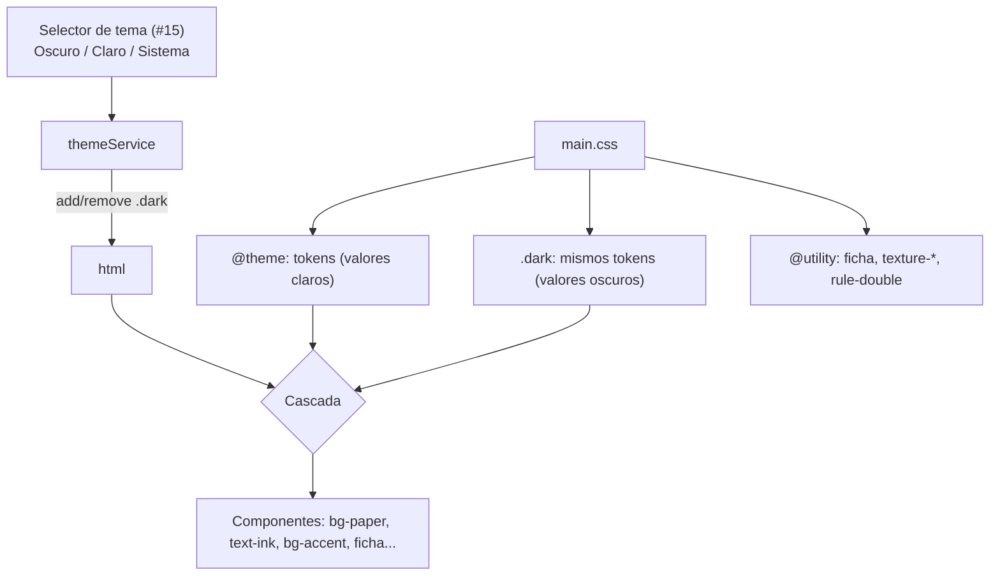

# ADR-016: Tema retro de biblioteca con tokens semánticos (`retro_library_theme`)

## Estado
Aceptado (pendiente de revisión)

## Contexto

Hasta la feature #15 la regla era "funcionalidad antes que estética": la UI usaba
~600 clases de color crudas (`slate-*`, `indigo-*`, `sky-*`, `emerald-*`...) pensadas
para fondo oscuro. Sólo `App.tsx` y `SettingsPage.tsx` tenían variantes `dark:`, así
que el tema claro del selector de #15 prácticamente no existía.

El usuario pidió una fase de estilizado con identidad propia:

- Inspiración: una biblioteca. Marrones oscuros y claros, cozy, "retro moderado" de
  la década pasada; que no parezca genérico, pero tampoco recargado.
- Dos temas sobre el selector existente: **oscuro** = biblioteca de noche (nogal,
  cuero, luz cálida de lámpara); **claro** = papel/pergamino con tinta marrón.
  "Sistema" debe seguir funcionando.
- Texturas sutiles sin imágenes externas, sombras suaves con relieve, títulos serif,
  tarjetas tipo ficha de catálogo, filetes dobles discretos.
- Fuentes serif empaquetadas (offline).
- **Sólo piel**: sin cambios de layout, comportamiento ni `data-testid`. La
  estantería es la feature #17.

## Decisión

### 1. Tokens semánticos con `@theme` + override en `.dark`

- `main.css` declara en `@theme` los tokens de color con los valores del tema
  **claro** (`--color-paper`, `--color-ink`, `--color-accent`, `--color-status-*`...).
- Bajo `@layer base { .dark { ... } }` se reasignan **las mismas variables** con
  los valores oscuros. Al estar en una capa posterior a `theme`, gana sin pelear
  especificidad.
- Todos los componentes y páginas de `src/renderer` usan sólo tokens. Se eliminaron
  todas las variantes `dark:`.
- `themeService` y `@custom-variant dark` no cambian: el selector de #15
  (Oscuro/Claro/Sistema) sigue agregando/quitando `.dark` en `<html>`.

Paleta (hex):

| Token | Claro (pergamino) | Oscuro (biblioteca de noche) | Uso |
|-------|------------------|------------------------------|-----|
| `paper` | `#f2e8d5` | `#1c1410` | fondo de la app |
| `card` | `#fbf5e9` | `#271c16` | fichas, modales |
| `well` | `#ebe0cb` | `#140e0b` | inputs (hundido) |
| `shelf` | `#e6d7bc` | `#33261d` | chips, hover, tapa sin imagen |
| `chrome` | `#3a2a1f` | `#120c09` | barra de título (madera) |
| `backdrop` | `#1a120c` | `#0b0705` | velo de modales/drawer |
| `ink` | `#2e2018` | `#eee0c8` | texto principal |
| `ink-muted` | `#5c4636` | `#c2ad90` | texto secundario |
| `ink-faint` | `#7d6753` | `#9e8870` | metadatos, placeholders |
| `chrome-ink` | `#ebddc4` | `#e3d2b5` | texto sobre madera |
| `chrome-muted` | `#bca88a` | `#a08b70` | iconos sobre madera |
| `rule` | `#d3bf9c` | `#45352a` | bordes |
| `rule-strong` | `#b09572` | `#64503f` | filetes dobles, hover |
| `accent` | `#8a4b22` (siena) | `#d9a25b` (luz de lámpara) | acción primaria, activo |
| `accent-strong` | `#713a18` | `#e8b874` | hover del acento |
| `accent-ink` | `#fbf5e9` | `#1c1410` | texto sobre acento |
| `brass` | `#c9974a` | `#d9a25b` | detalles dorados (iconos en cuero/madera) |
| `leather` | `#7a2e25` | `#7e3528` | emblemas de cuero, marcador activo |
| `spine` | `#2f4a3a` | `#4f7258` | lomo verde (reservado para #17) |
| `danger` | `#a3352a` | `#e58a78` | errores, borrar |
| `success` | `#4e6b30` | `#a7c285` | confirmaciones |
| `star` | `#b07a22` | `#e9b85a` | estrellas |
| `status-to-read` | `#3f5f7a` (azul tinta) | `#9db9d0` | Por leer |
| `status-reading` | `#4e6b30` (oliva) | `#afc889` | Leyendo |
| `status-paused` | `#8a5e12` (ocre) | `#e6bc64` | Pausado |
| `status-finished` | `#6e3f68` (ciruela) | `#d3a6cb` | Terminado |
| `status-abandoned` | `#a3402f` (ladrillo) | `#ec9580` | Abandonado |

Los cinco estados son tonos de "tinta antigua" (azul, oliva, ocre, ciruela, ladrillo):
armónicos con los marrones pero con matices claramente distintos. Todos superan 4.5:1
sobre `card` y `paper` en ambos temas (verificado por test).

### 2. Piezas de estilo reutilizables (`@utility`)

- `texture-paper` / `texture-wood`: SVG inline (`feTurbulence`) como `data:` URI;
  la veta de madera es el mismo ruido estirado en X. Opacidad distinta por tema.
- `ficha`: ficha de catálogo (fondo `card` + grano + borde + filete interior con dos
  `box-shadow inset` + sombra de relieve). `ficha-float` profundiza la sombra para
  modales cambiando `--ficha-elevation` (no `box-shadow`, para no competir con `ficha`).
- `rule-double`: filete doble bajo encabezados de página y modales.
- Sombras `shadow-xs/sm/md/2xl` redefinidas en `@theme` con colores en variables
  (`--relief-*`) para que sean cálidas en claro y densas en oscuro.
- Radios más contenidos (`rounded-xl/2xl` → `rounded-md/lg`) para un look más impreso.

### 3. Tipografía: Lora (texto) + Libre Baskerville (títulos)

- **Lora** (`@fontsource-variable/lora`, variable 400–700 + itálica): serif diseñada
  para lectura en pantalla, con buena legibilidad en tamaños chicos (la UI usa mucho
  `text-xs`). Al ser variable cubre `font-medium/semibold/bold` con un solo archivo.
- **Libre Baskerville** (`@fontsource/libre-baskerville`, 400/600/700 + itálica 400,
  sólo subset latin): Baskerville es *la* tipografía de libro clásica; con su alto
  contraste da carácter a los títulos (`h1–h4` vía regla base y `font-display`).
- Se importan en `main.tsx`; Vite empaqueta los `.woff2`. CSP ampliada con
  `font-src 'self' data:`.

### 4. Cambios puntuales de "piel"

- Barra de título y cabecera del drawer: madera (`chrome` + `texture-wood`).
- Emblemas de página (icono del encabezado): cuero con icono latón.
- Ítem activo del drawer: ficha con marcador de cuero a la izquierda.
- Autores en el detalle: itálica. Notas: fichas con línea punteada.
- Descripciones de los temas en Settings actualizadas a "Biblioteca de noche…" /
  "Papel de pergamino…".
- Scrollbar cálida (`::-webkit-scrollbar`, porque Chromium 120 no soporta
  `scrollbar-color`).

## Alternativas descartadas

- **Mantener clases crudas + agregar `dark:` en todos lados**: duplicaría ~600 clases,
  y cambiar la paleta seguiría requiriendo tocar cada archivo.
- **`@theme inline` con una capa de paleta (`--bl-*`) aparte**: más indirección sin
  beneficio real; `@theme` normal ya emite utilidades que referencian la variable.
- **Variables con `prefers-color-scheme` en CSS**: rompería las opciones explícitas
  "Oscuro"/"Claro" del selector de #15; la clase `.dark` ya resuelve "Sistema".
- **Google Fonts por CDN**: no funciona offline y requeriría abrir la CSP.
- **Imágenes PNG de textura**: más peso y assets binarios; el SVG con ruido pesa
  menos de 1 KB y se tiñe por tema.
- **EB Garamond / Playfair Display**: Garamond pierde legibilidad en tamaños chicos
  de UI; Playfair es demasiado "editorial/moda" para el tono cozy buscado.
- **Centralizar los `STATUS_CONFIG` duplicados** (BookCard, BookDetail, Dashboard):
  sería un refactor de estructura, fuera del alcance "sólo piel". Queda anotado.

## Consecuencias

- Cambiar la paleta = editar `main.css`. Ningún componente conoce hex ni nombres de
  la paleta de Tailwind.
- `tests/renderer/test_retro_library_theme.test.ts` impide regresiones: sin colores
  crudos ni `dark:`, todos los tokens usados existen, todo token tiene valor oscuro,
  contraste AA, texturas inline, fuentes empaquetadas y CSP.
- El test de pestañas de `AddBookModal` ahora valida el token `text-accent`.
- El bundle suma ~0,5 MB de fuentes (woff + woff2, todos los subsets de Lora); los
  subsets no latinos sólo se descargan si aparecen esos caracteres (`unicode-range`).

## Diagrama

