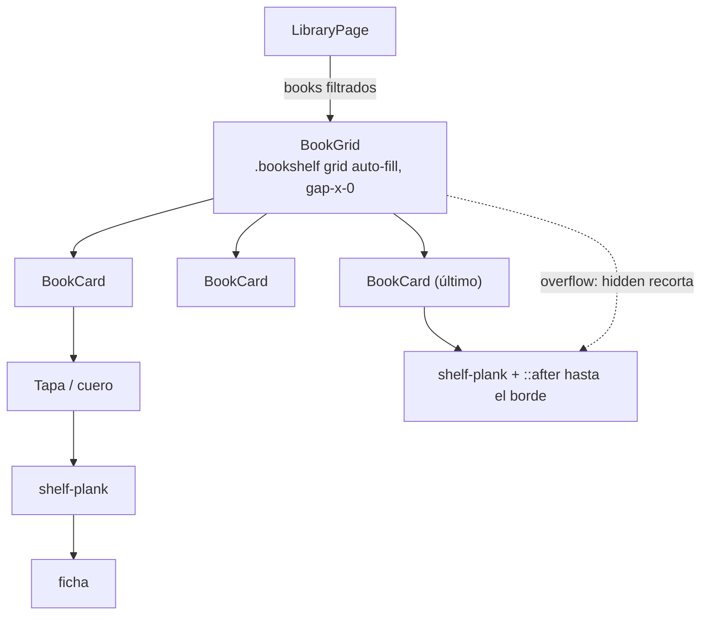

# ADR-017: Biblioteca como estantería (`library_bookshelf_view`)

## Estado
Aceptado (pendiente de revisión)

## Contexto

La feature #16 le dio a la app una piel de "biblioteca retro" (tokens, texturas,
fichas), pero la vista Biblioteca seguía siendo una grilla genérica de tarjetas con
breakpoints fijos (`sm:grid-cols-2 md:grid-cols-3 lg:grid-cols-4`). El usuario decidió:

- Los libros (tapas) se muestran **parados sobre estantes de madera** hechos con CSS,
  con relieve/sombra, estilo retro moderado.
- **Debajo** del estante, una ficha chica con título, autor, badge de estado,
  progreso (cuando aplica) y estrellas: no se pierde información respecto del
  `BookCard` anterior.
- Sin tapa: libro de cuero (`leather`/`spine`) con detalles en latón (`brass`).
- Responsive: los libros por estante se adaptan al ancho.
- Se conservan filtros, estado vacío, click al detalle y todos los `data-testid`.
- Sólo cambia la presentación de la Biblioteca.

## Decisión

### 1. Layout: CSS grid `auto-fill` donde cada celda dibuja su tramo de estante

`BookGrid` es un grid
`grid-cols-[repeat(auto-fill,minmax(9.5rem,1fr))] gap-x-0 gap-y-10`. Cada `BookCard`
(celda) apila **tapa → tramo de estante (`shelf-plank`) → ficha**. Como no hay
separación horizontal y todas las tapas de una fila tienen la misma altura
(`aspect-[2/3]` sobre el mismo ancho `1fr`), los tramos se tocan y se leen como un
único estante continuo. La separación visual entre libros es padding interno de la
celda.

La última fila incompleta se completa con un `::after` en el tramo del último libro
(`left: 100%; width: 100vw; background: inherit`) recortado por el contenedor
(`bookshelf` → `overflow: hidden`, sin padding lateral).

**Por qué es la opción más simple y robusta**: es CSS puro; no hay estado, ni
mediciones, ni re-render al redimensionar; el navegador decide las columnas y el
estante lo sigue automáticamente. Funciona igual en jsdom (los tests validan la
estructura) y no depende de que un cálculo en JS coincida con el CSS.

### 2. Madera derivada de tokens existentes

`@utility shelf-plank` no agrega tokens: mezcla `chrome` y `brass` con `color-mix`
(cara superior más clara, frente más oscuro), le superpone `texture-wood` y usa las
sombras `--relief-deep` del tema. Al depender sólo de variables, cambia sola entre
claro (nogal sobre pergamino) y oscuro (madera cálida sobre fondo nocturno). Se
documentó en `conventions.md` y en la guía de tokens.

### 3. Ficha debajo del estante

La información pasa de la tarjeta a una `ficha` (la utilidad de #16) debajo del
estante. El badge de estado **deja de superponerse a la tapa** y va en la ficha junto
a las estrellas (la tapa queda limpia, como un libro real). Título en
`font-display`, autor en itálica, progreso abajo cuando el estado lo tiene. Las fichas
de una fila se igualan en altura (`flex-1` + estiramiento del grid).

### 4. Placeholder de cuero

`bg-leather` o `bg-spine` (alternado por `id`, determinista, expuesto en
`data-cover-tone`), con `texture-paper`, marco `border-double border-brass/60` e icono
`text-brass`. `book-hinge` (degradado del pliegue del lomo) se aplica también a las
portadas reales. Así se usa el token `spine`, reservado en #16 para esta feature.

### 5. Interacción

Toda la celda (tapa, estante y ficha) es clickeable y abre el detalle, como antes. Al
pasar el mouse el libro se levanta levemente (`-translate-y-1`) y el título toma el
color de acento. `LibraryPage` no cambió.

## Alternativas descartadas

- **Agrupar en filas desde JS** (`ResizeObserver` + `chunk(books, cols)` + un
  `<Shelf>` por fila): más código y estado, re-render al redimensionar, necesita mocks
  en jsdom y duplica en JS una decisión que el grid ya toma.
- **Fondo del contenedor con estantes repetidos** (`repeating-linear-gradient` cada N
  px): exige filas de altura fija; las fichas tienen altura variable (el progreso es
  opcional, los títulos ocupan 1 o 2 líneas), así que el estante quedaría desfasado.
- **Breakpoints fijos** (`sm:/md:/lg:grid-cols-*`) como antes: con un estante el ancho
  de cada libro debería ser estable; `auto-fill` evita libros gigantes en ventanas
  anchas y no requiere pensar breakpoints.
- **Dejar la última fila con el estante cortado**: se ve como un estante roto.
- **Flexbox con `flex-wrap`**: los tramos de la última fila también quedan cortos y
  los anchos de celda varían entre filas; el grid da columnas uniformes.
- **Tokens nuevos para la madera** (`wood`, `wood-edge`): innecesarios; `color-mix`
  de `chrome` y `brass` da el tono correcto en ambos temas sin crecer la paleta.
- **Título del libro impreso en el placeholder**: duplica texto en el DOM (rompe
  búsquedas por texto en tests y lectores de pantalla); la ficha ya muestra el título.

## Consecuencias

- `BookGrid`/`BookCard` cambiaron; `data-testid` existentes conservados. Se agregaron
  `book-cover`, `shelf-plank`, `book-ficha` y `book-cover-placeholder-frame`.
- `main.css` suma `@utility shelf-plank`, `bookshelf` y `book-hinge`, sin colores fijos.
- El test de layout de `test_library_view.test.ts` ahora valida el grid `auto-fill`
  sin breakpoints y un tramo de estante por libro; `test_library_bookshelf_view.test.ts`
  cubre la estructura, la ficha, el placeholder, el CSS y la integración con
  `LibraryPage`.
- Hay un solo `BookCard` en la app (sólo lo usa `BookGrid`), así que no afecta
  Dashboard, Detalle ni Settings.

## Diagrama

