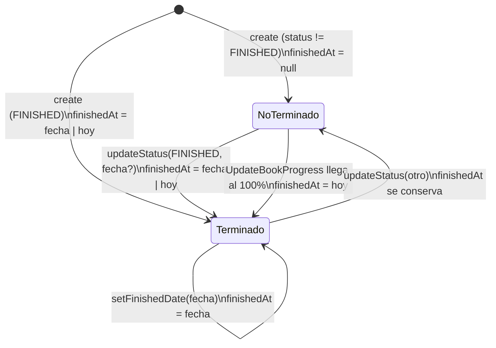
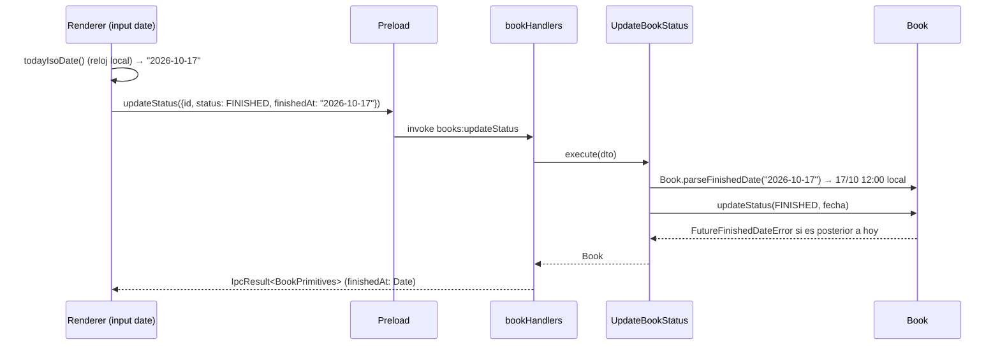

# ADR-020: Fecha de terminado de un libro (`finished_date`)

## Estado
Aceptado (pendiente de revisión)

## Contexto

Hasta ahora un libro "terminado" era sólo un `status = FINISHED`: no se sabía *cuándo* se
terminó. El dashboard no podía responder "¿cuántos libros terminé este año / este mes?" y
la lista de recientes se ordenaba por `updatedAt`, que cambia con cualquier edición
(calificar, mover el progreso, etc.).

Decisiones del usuario que acotan el diseño:

- Al marcar un libro como terminado se pide la fecha, con **hoy** precargado.
- Si se termina solo al llegar al 100% (`UpdateBookProgress`), se usa hoy **sin preguntar**.
- Los libros que ya estaban FINISHED se migran con `finishedAt = updatedAt`.
- Si el libro sale de FINISHED, la fecha **se conserva**; al volver a terminarlo se pide
  de nuevo y se **sobrescribe**.
- No se aceptan fechas futuras (error de dominio tipado).
- Se muestra en el detalle (editable), en la ficha del estante (si está FINISHED) y se usa
  en el dashboard.

## Decisión

### 1. Representación de la fecha: día calendario a mediodía local

La fecha de terminado es un **día**, no un instante. Se eligió:

- **En dominio y base**: `Date` / `DateTime?` a las **12:00 hora local** de ese día
  (`toCalendarNoon`). Prisma lo guarda como instante UTC, pero al leerlo y mostrarlo en
  la hora local se recupera siempre el mismo día: el mediodía deja ±12 h de margen, más
  que cualquier huso horario habitual y que los saltos de horario de verano.
- **En los bordes (IPC e `<input type="date">`)**: texto ISO `YYYY-MM-DD`. Es lo que
  produce y consume el input nativo, no tiene zona horaria y no depende de cómo
  `structuredClone` serialice un `Date`. El use case lo convierte con
  `Book.parseFinishedDate`, que lanza `InvalidFinishedDateError` si el formato o el día
  son inválidos (p. ej. `2026-02-30`).
- **"Hoy"** se calcula siempre con el reloj **local** (`todayIsoDate()` en
  `src/shared/domain/entities/CalendarDate.ts`), nunca con `toISOString().slice(0, 10)`:
  en Argentina (UTC−3), después de las 21:00 `toISOString` ya devuelve el día siguiente
  y el "hoy" precargado se correría un día. El renderer no armaba hasta ahora ninguna
  fecha "de hoy"; las helpers nuevas evitan que se introduzca ese error.
- "Fecha futura" se compara por **día calendario local** (`isAfterToday`), no por
  instante: terminar un libro "hoy a las 23:59" es válido.
- Main y renderer corren en la misma máquina (misma zona horaria), así que el "hoy" del
  dominio (main) y el del input (renderer) coinciden.

Los libros migrados conservan la hora exacta de su `updatedAt` (no se normalizan a
mediodía en SQL); al mostrarlos en hora local se ve el día en que se tocaron por última
vez, que es justamente lo que se pidió.

### 2. Dominio (`Book`)

- Campo `finishedAt: Date | null` (getter, `BookProps`, `BookPrimitives`).
- `Book.create`: si nace FINISHED, `finishedAt` = la fecha dada o hoy; si no, `null`.
- `updateStatus(status, finishedAt?)`:
  - a FINISHED con fecha → valida y la asigna (sobrescribe);
  - a FINISHED sin fecha desde otro estado → hoy (cubre el autocompletado al 100%);
  - a FINISHED sin fecha estando ya FINISHED → conserva la existente;
  - a otro estado → conserva `finishedAt`; pasar fecha con un estado ≠ FINISHED lanza
    `InvalidFinishedDateError`.
- `setFinishedDate(date)`: sólo para libros FINISHED (si no, `InvalidFinishedDateError`).
- Errores nuevos en `DomainErrors.ts`: `InvalidFinishedDateError` y
  `FutureFinishedDateError`. Ambos son `DomainError`, así que `formatIpcError` los
  devuelve como `VALIDATION_ERROR` sin cambios.
- El constructor valida que una `finishedAt` recibida no sea futura ni inválida.

### 3. Persistencia

- `schema.prisma`: `finishedAt DateTime?`.
- Migración `20261017212053_add_book_finished_at`, generada con
  `prisma migrate dev --create-only` y **editada a mano** para agregar el backfill:
  `UPDATE "Book" SET "finishedAt" = "updatedAt" WHERE "status" = 'FINISHED' AND "finishedAt" IS NULL;`
  (ver guía `prisma-sqlite-setup.md` §6).
- `BookMapper` mapea el campo en ambas direcciones; `PrismaBookRepository` no cambia.

### 4. Aplicación e IPC

- `AddBookDTO.finishedAt?` y `UpdateBookStatusDTO.finishedAt?` (`YYYY-MM-DD`).
- Use case nuevo `SetFinishedDate` + canal `books:setFinishedDate`
  (`IPC_CHANNELS.BOOKS.SET_FINISHED_DATE`), handler, preload y
  `bookService.setFinishedDate`.
- `UpdateBookProgress` no cambia: su `updateStatus(FINISHED)` sin fecha asigna hoy.

### 5. UI

- `FinishedDateField` (input `type="date"`, `max` = hoy, error en línea) y helpers
  `finishedDate.ts` (`defaultFinishedDateInput`, `validateFinishedDateInput`,
  `formatFinishedDate` en `es-AR` → `17/10/2026`).
- **AddBookModal**: con estado "Terminado" aparece el campo (hoy precargado).
- **UpdateProgressModal**: con el checkbox "¿Marcar libro como terminado?" tildado
  aparece el campo; se envía en `updateStatus(id, FINISHED, fecha)`. Si el libro ya
  estaba FINISHED se precarga su fecha actual en vez de hoy. El formulario pasó a
  `noValidate` para que la validación de la fecha muestre el mensaje propio en lugar
  del globo nativo (las demás validaciones ya estaban en el código).
- **Detalle**: elegir "Terminado" en el selector ya no guarda directo: abre una
  confirmación con la fecha (hoy) y botones Confirmar/Cancelar. Con el libro FINISHED se
  muestra "Terminado el dd/mm/aaaa" con "Editar fecha" (`setFinishedDate`).
- **Ficha del estante** (`BookCard`): "Terminado el dd/mm/aaaa" sólo si está FINISHED.
- **Dashboard**: sección "Libros terminados" con terminados en el año y en el mes
  actuales (según `finishedAt`, calendario local) y "Terminados recientemente" ordenados
  por `finishedAt` (hasta 5). Sólo cuentan los libros actualmente FINISHED: un libro
  reabierto conserva la fecha pero no suma. La sección "Libros recientes" existente
  (por `updatedAt`) se mantiene.
- Sólo tokens del tema (#16/#17); se conservan todos los `data-testid` existentes.

### Diagrama

## Alternativas descartadas

- **Guardar el día como `String` `YYYY-MM-DD` en la base**: evita husos horarios, pero
  el criterio de aceptación pide `DateTime?` y se pierden las consultas por fecha.
- **Medianoche UTC (`new Date("2026-10-17")`)**: en UTC−3 se muestra como el 16/10. Es
  el error clásico que este diseño evita.
- **Medianoche local**: el día se corre si cambia la zona horaria o en días con salto de
  horario de verano a medianoche (ocurre en algunos países); el mediodía es más robusto.
- **Pasar `Date` por IPC**: funciona por `structuredClone`, pero el input nativo ya da
  texto y convertirlo a `Date` en el renderer duplicaría la lógica de zona horaria.
- **Backfill desde código al arrancar la app**: correría en cada inicio y mezclaría
  migración de datos con lógica de la app. El `UPDATE` dentro de la migración corre una
  sola vez y queda versionado junto al cambio de esquema.
- **Borrar `finishedAt` al salir de FINISHED**: descartado por decisión del usuario.
- **Pasar la fecha en `UpdateBookProgressDTO`** para el checkbox del modal: se mantuvo el
  flujo existente (progreso + `updateStatus`) para no tocar el contrato de progreso.
- **Permitir editar la fecha de un libro no terminado**: mostraría "Terminado el…" en un
  libro que se está leyendo; se restringió a FINISHED.
