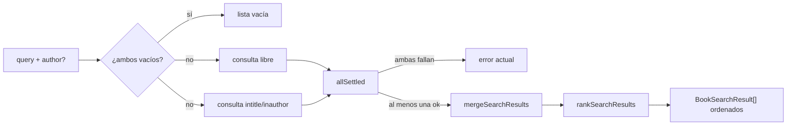

# ADR-021: Relevancia de la búsqueda en Google Books

## Estado
Aceptado (pendiente de revisión)

## Contexto

La búsqueda del modal "Agregar libro" mandaba una sola consulta
`q=<texto>&maxResults=20` y mostraba los resultados en el orden de Google. Para
"pet sematary" la novela de Stephen King no aparecía arriba: guías de estudio, revistas y
traducciones le ganaban. No había `printType`, ni operadores de campo, ni reordenamiento
local.

Decisiones del usuario que acotan el diseño:

- Mostrar **todas** las ediciones (no filtrar ni agrupar).
- **Sin** preferencia de idioma.
- Agregar un campo **autor opcional**; la búsqueda funciona con sólo título, sólo autor o
  ambos.
- La verificación contra la API real la hace el usuario; los tests usan respuestas grabadas.

## Decisión

### 1. Dos consultas en paralelo

`GoogleBooksService.searchByQuery(query, author?)` lanza con `Promise.allSettled`:

- **libre**: `q=<texto> <autor>`;
- **de campo**: `q=intitle:"<texto>" inauthor:"<autor>"` (cada operador sólo si su valor no
  está vacío; las comillas internas se quitan para no romper la frase).

Ambas con `printType=books` (excluye revistas) y `maxResults=40` (el máximo de la API, para
que la edición buscada entre en la ventana aunque Google la ordene mal).

Los resultados se combinan con `mergeSearchResults(campo, libre)`: sin duplicados por
`googleBooksId` (gana la primera aparición; los que no tienen id se conservan todos).

**Fallos parciales**: si una consulta falla (red o HTTP), se usan los resultados de la otra.
Si fallan ambas se propaga el error de la consulta libre, que tiene el mismo mensaje que
antes (`Error en la consulta a Google Books API: HTTP ...`), así la UI muestra el error actual.

### 2. Ranking local como servicio de dominio puro

`src/shared/domain/services/rankSearchResults.ts` puntúa cada resultado (pesos en
`RELEVANCE_WEIGHTS`): título exacto 100, prefijo 60, frase contenida 45, si no proporción de
palabras hasta 30; autor del campo hasta 50, o autor detectado en el texto libre hasta 40;
portada +10, ISBN +5, páginas +5. Orden estable: ante empate se respeta el orden combinado.
Nunca descarta resultados.

Se ubica en el dominio porque "qué es relevante para el lector" es una regla de BookLog, no
de Google: no depende de HTTP, se testea sin red y serviría para otra fuente. El adaptador
sólo arma consultas, las combina y delega el orden.

### 3. Contrato IPC compatible

- Port: `searchByQuery(query: string, author?: string | null)`.
- `SearchBooksDTO`: `{ query: string; author?: string | null }`.
- El handler de `search:books` sigue aceptando un **string suelto**; recorta ambos valores,
  devuelve `[]` si los dos están vacíos y llama a `searchByQuery(query)` (un argumento) cuando
  no hay autor, igual que antes.
- Preload: `search.books(query, author?)` envía `{ query }` o `{ query, author }`.

### 4. UI

Input "Autor (opcional)" (`data-testid="search-author-input"`) debajo del buscador, con los
mismos tokens de estilo. Se busca cuando cualquiera de los dos campos tiene ≥ 3 caracteres.
El debounce de 500 ms y `searchRequestIdRef` se comparten entre ambos inputs. El mensaje de
"sin resultados" muestra `texto — autor`.

## Alternativas descartadas

- **Sólo agregar `intitle:`**: pierde resultados con títulos aproximados o subtítulos y no
  sirve para búsquedas por ISBN o por autor solo.
- **Consultas secuenciales (de campo y, si no alcanza, libre)**: duplica la latencia en el
  caso común y la regla de "alcanza" sería arbitraria.
- **Confiar en `orderBy=relevance`**: es el orden por defecto de Google; justamente es el que
  falla.
- **Ranking dentro de `GoogleBooksService`**: mezclaría reglas de negocio con HTTP y obligaría
  a testear el orden a través del adaptador.
- **Filtrar guías/revistas por palabras clave o por idioma**: el usuario pidió conservar todas
  las ediciones y no priorizar idioma; el puntaje sólo reordena.
- **Cambiar el handler para pasar siempre `(query, author)`**: rompería la compatibilidad de
  la llamada de un argumento que ya usaban los tests y otros consumidores.

## Diagrama

