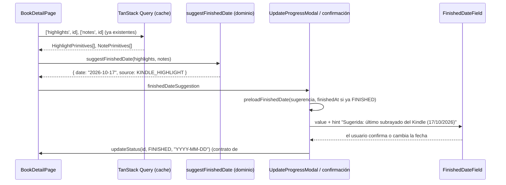
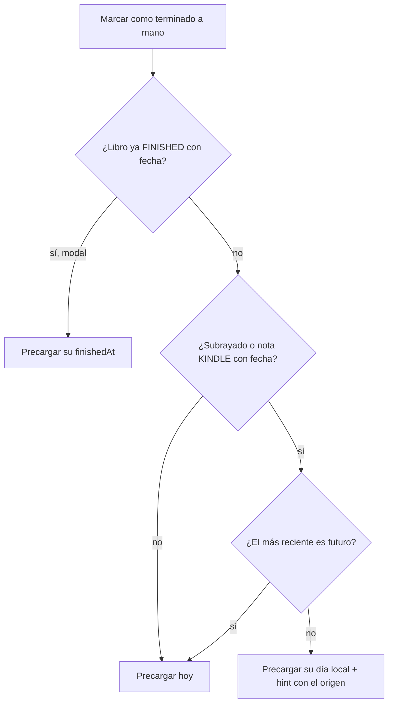

# ADR-024: Fecha de terminado sugerida desde los subrayados del Kindle (`finished_date_from_clippings`)

## Estado
Aceptado (pendiente de revisión)

## Contexto

Desde #20 (ADR 020), al marcar un libro como terminado a mano se pide la fecha con **hoy**
precargado. Desde #22/#23 (ADR 022 y 023) los libros pueden tener subrayados y notas
importados del Kindle, cada uno con la fecha en que se capturó en el dispositivo
(`capturedAt`). Si el usuario lee en el Kindle y marca el libro como terminado en BookLog
días después, "hoy" es una mala sugerencia; el último subrayado es una aproximación mucho
mejor del día en que terminó.

Acotaciones de la feature:

- Aplica a los caminos manuales a FINISHED: checkbox "¿Marcar libro como terminado?" de
  `UpdateProgressModal` y confirmación del cambio de estado en `BookDetailPage`.
  `AddBookModal` no aplica (un libro nuevo no tiene subrayados).
- La sugerencia es la fecha del último subrayado o nota de origen KINDLE, si existe y no es
  futura; si no, hoy. El usuario puede cambiarla.
- La UI indica de dónde sale la sugerencia.
- El autocompletado al 100% (`UpdateBookProgress`) sigue usando hoy sin preguntar.
- No se agrega fecha de inicio.

## Decisión

### 1. Regla de dominio pura: `suggestFinishedDate`

`src/shared/domain/services/suggestFinishedDate.ts`:

```ts
suggestFinishedDate(highlights, notes, now = new Date()): FinishedDateSuggestion
// { date: 'YYYY-MM-DD', source: 'KINDLE_HIGHLIGHT' | 'KINDLE_NOTE' | 'TODAY' }
```

- Toma el `capturedAt` más reciente entre **todos los subrayados** (sólo se crean por la
  importación del Kindle) y las **notas con `origin = KINDLE`**. Las notas MANUAL no
  cuentan: su fecha es la de cuando se escribieron en BookLog, no la de la lectura.
- Se ignoran fechas nulas o inválidas. Ante un empate gana el subrayado (una nota del Kindle
  suele ser el comentario de ese mismo subrayado).
- El instante se convierte a **día calendario local** con `toIsoDate` de `CalendarDate`
  (nunca `toISOString`, ver ADR 020): un subrayado del 15/10 a las 23:30 en UTC−3 se sugiere
  como 15/10, no 16/10.
- Si el más reciente es **posterior a hoy** (comparando días locales con `isAfterToday`) se
  sugiere hoy. Es la lectura literal del criterio ("si existe y no es futura; si no, hoy"):
  una fecha futura indica que el reloj del Kindle estaba mal y, entonces, las demás fechas
  del dispositivo tampoco son confiables.
- Las entradas son interfaces estructurales mínimas (`DatedHighlight`, `DatedNote`), que
  `HighlightPrimitives` y `NotePrimitives` cumplen; acepta `Date` o texto ISO.

Vive en `domain/services` junto al ranking de búsqueda (#21) y los servicios del Kindle
(#23): es una regla de negocio sin IO, testeable sin mocks y reutilizable si el día de mañana
el main process necesitara la misma sugerencia.

### 2. Sin canal IPC nuevo: se reusan las queries del detalle

Los dos caminos afectados están en el detalle del libro (`UpdateProgressModal` sólo se abre
desde `BookDetailPage`), que ya carga `['notes', bookId]` y `['highlights', bookId]` con
TanStack Query. `BookDetailPage` calcula la sugerencia con `useMemo` sobre esos datos y:

- la usa al abrir la confirmación del cambio de estado a "Terminado";
- la pasa a `UpdateProgressModal` por la prop opcional `finishedDateSuggestion`.

Si alguna query falla o todavía no llegó, la lista se trata como vacía y se sugiere hoy (el
comportamiento de #20): la sugerencia es una comodidad, no debe bloquear el flujo.

### 3. Prioridad del valor precargado (`preloadFinishedDate`)

Helper en `src/renderer/src/components/finishedDate.ts`:

1. **Fecha existente**, si se pasa una → sin hint;
2. si no, **sugerencia del Kindle** → con hint;
3. si no, **hoy** (recalculado en el momento, por si la sugerencia se memorizó antes de la
   medianoche) → sin hint.

Cómo se aplica a los casos de re-terminar, conservando #20:

| Camino | Estado del libro | #20 precargaba | #24 precarga |
|---|---|---|---|
| Checkbox de `UpdateProgressModal` | ya FINISHED (con `finishedAt`) | su `finishedAt` | **su `finishedAt`** (sin cambios) |
| Checkbox de `UpdateProgressModal` | no FINISHED, aunque conserve un `finishedAt` viejo | hoy | Kindle o hoy |
| Confirmación en el detalle | no FINISHED (con o sin `finishedAt` viejo) | hoy | Kindle o hoy |
| Confirmación en el detalle | ya FINISHED | no se abre (el selector no cambia) | igual |
| "Editar fecha" de un libro FINISHED | FINISHED | su `finishedAt` | igual (no es un camino a FINISHED) |

Es decir: #20 nunca precargaba el `finishedAt` conservado de un libro reabierto (pedía "de
nuevo, con hoy" y sobrescribía); en ese caso #24 sólo reemplaza "hoy" por la sugerencia del
Kindle. Cuando el libro ya está FINISHED, el modal sigue mostrando su fecha actual, que es
una decisión explícita del usuario y tiene prioridad sobre cualquier sugerencia.

### 4. Indicador de origen en la UI

`FinishedDateField` gana una prop opcional `hint` que se muestra debajo del input
(`text-ink-muted`, `data-testid="<testId>-hint"`):

- `Sugerida: último subrayado del Kindle (17/10/2026)`
- `Sugerida: última nota del Kindle (12/10/2026)`

Cuando la sugerencia es hoy, o se precarga la fecha existente, no se muestra hint (la UI
queda igual que en #20). El hint sigue visible si el usuario cambia la fecha: describe la
sugerencia, no el valor actual. Sólo tokens de color; se conservan todos los `data-testid`.

### 5. Autocompletado al 100%

`UpdateBookProgress` y la entidad `Book` no cambian: al llegar al 100% sin pasar por el
checkbox, `updateStatus(FINISHED)` sin fecha sigue asignando hoy (ADR 020 §2, cubierto por
`tests/application/test_finished_date_use_cases.test.ts`).

### Diagrama





## Alternativas descartadas

- **Use case `GetLastKindleAnnotationDate` + canal IPC**: más "por el libro", pero agrega
  use case, puerto/consulta, handler, preload y servicio para datos que el renderer ya tiene
  en caché en la única pantalla donde se usan. La regla igualmente quedó en el dominio, así
  que convertirla en use case más adelante es trivial.
- **Calcular la sugerencia en el main dentro de `UpdateBookStatus`** cuando no llega fecha:
  cambiaría el significado de "sin fecha" para el autocompletado al 100% (que debe seguir
  siendo hoy) y la sugerencia no se podría mostrar antes de confirmar.
- **Saltear las fechas futuras y usar la última no futura**: también razonable, pero se
  apartaba de la letra del criterio y confía en un reloj que ya demostró estar mal.
- **Contar las notas manuales**: su fecha es la de escritura en BookLog, no la de lectura.
- **Usar `createdAt` de lo importado**: es la fecha de la importación, no la de lectura.
- **Precargar el `finishedAt` conservado de un libro reabierto**: #20 decidió pedir la fecha
  de nuevo y sobrescribir; se mantuvo.
- **Mostrar un hint también para "hoy"**: ruido; "hoy" ya era el comportamiento por defecto.
