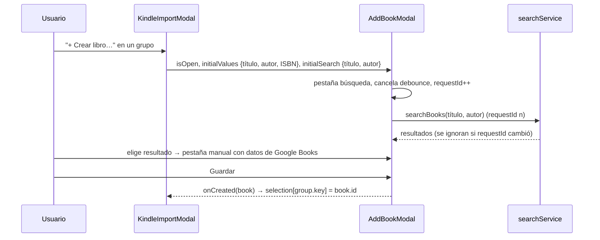

# ADR-025: Ajustes de la importación del Kindle (`kindle_import_refinements`)

## Estado
Aceptado (pendiente de revisión)

## Contexto

El usuario probó la importación de la #23 (ADR 023) con su Kindle y pidió tres ajustes:

1. **Notas repetidas.** El Kindle autoguarda la nota mientras se escribe y cada corrección
   agrega una entrada nueva en la misma ubicación. La regla de la #23 (una nota es borrador
   si una más nueva en la misma ubicación **empieza** con su texto) solo detecta borradores
   que son prefijo. Las correcciones en el medio del texto no lo son: casos reales
   `mulholland drive, influenxiq` → `influenx` → `influencia?` (2 s entre cada una) o
   `Y pq es mas dificil…` → `Y tambien pq es mas dificil…` (5 min después). Con la muestra
   real quedaban **302 notas**, de las cuales ~256 eran versiones intermedias.
2. **Orden de la vista previa**: con 38 títulos, el orden del archivo no ayuda a decidir.
3. **Crear libro**: el `AddBookModal` abría en la pestaña manual con el título y el autor
   normalizados, sin datos de Google Books (portada, páginas, ISBN). El usuario tenía que
   pasar a la pestaña de búsqueda y volver a escribir lo mismo.

Decisiones del usuario (descripción de la #25): una sola nota por ubicación, la más
reciente; las notas ya importadas no se tocan (las borra él); orden por subrayados (por
defecto), notas, última fecha y título; la búsqueda se precarga con título y autor
normalizados (campo de autor de la #21) y se ejecuta sola.

## Decisión

1. **Una nota por ubicación** (`keepLatestNotePerLocation` en
   `resolveKindleAnnotations.ts`, reemplaza a `isNoteDraft`). Dentro de un grupo (un
   encabezado del Kindle, ya que las posiciones solo son comparables dentro de la misma
   edición), las notas se agrupan por `noteLocationKey`: `pos:<rango>` si la nota tiene
   posición, si no `page:<rango>`; sin ninguna de las dos, la nota es única. Se conserva la
   más reciente con el mismo criterio que los subrayados (`isNewer`: fecha y, a igual fecha
   o sin fecha, orden en el archivo). El orden de salida sigue siendo el del archivo.
2. **Vínculo y huella sobre la nota resultante.** `findCommentedHighlight` y
   `kindleFingerprint` se aplican a la nota que queda, sin cambios en sus reglas. La huella
   (`kindle-v1`, tipo + ubicación + texto) **no cambia de versión**: la nota que queda es
   una entrada concreta del archivo y su huella es estable mientras el archivo no cambie.
   Si el usuario sigue corrigiendo la nota en el Kindle, la próxima importación trae una
   versión nueva con otra huella y se agrega (la vieja queda, igual que con los subrayados
   editados, ver "Limitaciones" del ADR 023).
3. **Notas ya importadas intactas.** `CommitKindleImport` sigue solo creando: no borra ni
   actualiza notas KINDLE guardadas con la regla de la #23. Si la versión final ya estaba
   importada, se omite por huella; las intermedias quedan para que el usuario las borre.
4. **Orden de la vista previa** (`sortKindleGroups` en `kindleImport.ts`, función pura):
   `HIGHLIGHTS` (desc, por defecto), `NOTES` (desc), `LAST_DATE` (desc, sin fecha al
   final) y `TITLE` (A-Z, `localeCompare` en castellano sin distinguir acentos ni
   mayúsculas). Empates por título y luego por clave. Devuelve una copia; la selección del
   modal sigue indexada por `group.key`, así que reordenar no altera las asignaciones. El
   selector (`data-testid="kindle-import-sort"`) se muestra con más de un grupo.
5. **Búsqueda inicial en `AddBookModal`**: prop opcional `initialSearch?: { query,
   author? }`. Al abrir con ella, el modal elige la pestaña de búsqueda, carga los dos campos
   y llama a `executeSearch` desde un efecto, sin pasar por el debounce de 500 ms. Al abrir
   (con o sin búsqueda inicial) se cancela el temporizador pendiente y se incrementa el
   `requestId`, así una respuesta de una apertura anterior o la automática que llega
   después de que el usuario buscó otra cosa se descarta. `initialValues` sigue precargando
   la pestaña manual. `KindleImportModal` pasa ambos memoizados a partir del grupo; los
   demás usos (sin `initialSearch`) no cambian.

## Alternativas descartadas

- **Mantener el prefijo y sumar similitud de texto** (distancia de edición, tramo común):
  agrega umbrales arbitrarios y igual falla con notas cortas (`influenx` vs `influencia?`);
  el usuario prefirió la regla simple.
- **Ventana de tiempo** (fusionar notas de la misma ubicación escritas con pocos segundos
  de diferencia): el caso `Y pq…` tiene 5 minutos entre versiones; cualquier ventana sería
  arbitraria.
- **Huella por ubicación (sin texto) o nueva versión `kindle-v2`**: haría que la nota
  "reemplace" a la anterior al reimportar, pero exigiría actualizar o borrar notas ya
  guardadas (el usuario pidió no tocarlas) y cambiaría la huella de todas las notas ya
  importadas, que se duplicarían al reimportar.
- **Borrar automáticamente las notas intermedias importadas con la #23**: decisión del
  usuario en contra; podría borrar notas que editó en BookLog.
- **Ordenar en el main / use case**: el orden es solo de presentación y cambia sin volver
  a leer el archivo; vive en el renderer.
- **Disparar la búsqueda inicial con el debounce** (simulando que el usuario escribió):
  medio segundo de espera sin motivo y depende de un temporizador en los tests.

## Resultados con la muestra real

| | Notas | Vinculadas |
|---|---|---|
| Regla #23 (prefijo) | 302 | 301 |
| Regla #25 (una por ubicación) | **46** | 45 |

Las 852 notas útiles del archivo y los 1446 subrayados resultantes no cambian.

## Diagrama

Ver también `docs/guides/kindle-clippings-import.md` §5 y §7.
