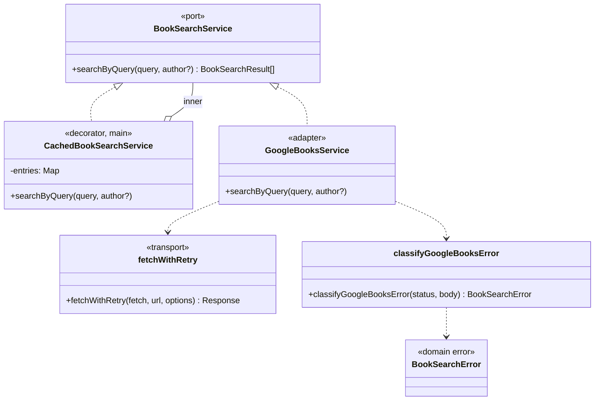

# ADR-027: Resiliencia de la búsqueda en Google Books (reintentos, caché y errores tipados)

## Estado
Aceptado (pendiente de revisión)

## Contexto

El usuario veía a menudo `Error en la consulta a Google Books API: HTTP 503 Service
Unavailable`. Google devuelve 503 transitorios, y son más frecuentes cuando llegan ráfagas.
Desde #21 cada búsqueda lanza **dos** consultas en paralelo (libre + `intitle:`/`inauthor:`,
ADR 021), y desde #25 el modal hace búsquedas automáticas al abrirse desde la importación del
Kindle (ADR 025). No había reintentos, y cualquier fallo llegaba a la UI como un `Error`
genérico con código `INTERNAL_ERROR`.

Decisión del usuario: reintento automático, caché corta y un mensaje claro con botón
"Reintentar". Se mantienen las dos consultas en paralelo.

## Decisión

### 1. Errores tipados como parte del contrato del port

`src/shared/domain/errors/BookSearchErrors.ts` define `BookSearchError` y cuatro subclases:

| Error | Cuándo | Código IPC |
|---|---|---|
| `SearchServiceUnavailableError` | 5xx o error de red, tras los reintentos | `SEARCH_UNAVAILABLE` |
| `SearchQuotaExceededError` | 429 tras los reintentos, o 400/403 con motivo de cuota (`dailyLimitExceeded`, `rateLimitExceeded`...) | `SEARCH_QUOTA_EXCEEDED` |
| `SearchApiKeyInvalidError` | 400/403 con motivo de key (`API_KEY_INVALID`, `keyInvalid`, `accessNotConfigured`...) o un mensaje que menciona "API key" | `SEARCH_INVALID_API_KEY` |
| `SearchRequestFailedError` | cualquier otro 4xx | `SEARCH_FAILED` |

Están en el dominio, junto al port `BookSearchService`, porque describen **cómo puede fallar
el port**, no cómo falla Google. Otro adaptador (Open Library, por ejemplo) lanzaría los mismos
errores y la UI no cambiaría. No extienden `DomainError`: ese tipo significa "dato inválido del
usuario" y `formatIpcError` lo mapea a `VALIDATION_ERROR`. `formatIpcError` revisa los errores
de búsqueda antes que `DomainError`.

Cuando fallan las dos consultas paralelas se propaga el error más informativo
(`pickMostRelevantError`): key inválida > cuota > no disponible > fallo genérico. Antes se
propagaba siempre el de la consulta libre. Si sólo falla una, se siguen usando los resultados
de la otra (sin cambios respecto de ADR 021).

### 2. Reintento dentro del adaptador, por petición HTTP

`src/shared/infrastructure/api/fetchWithRetry.ts` envuelve cada `fetch`:

- Reintenta 500, 502, 503, 504, 429 y errores de red. **No** reintenta otros 4xx (400, 401,
  403, 404): repetir una key inválida o una cuota diaria agotada no cambia el resultado.
- Hasta **2 reintentos** (3 llamadas). Espera `500 ms · 3^n` con jitter de ±20 %: ~0,5 s y
  ~1,5 s.
- Si viene `Retry-After` (segundos o fecha HTTP), se usa en vez del backoff, con un **tope de
  5 s** para no dejar la UI colgada.
- `sleep`, `random` y `now` se inyectan (`GoogleBooksService(fetch, key, { retry })`), así los
  tests verifican los tiempos sin esperar.
- Devuelve la última respuesta aunque no sea `ok`; `GoogleBooksService` la clasifica con
  `classifyGoogleBooksError(status, cuerpo)`, que lee el cuerpo JSON de error de Google si
  existe y, si no se puede leer, decide sólo por el status.

**Por qué dentro del cliente y no como decorador del port:** el port sólo ve el resultado
combinado de las dos consultas. Si una devuelve 503 y la otra 200, `searchByQuery` resuelve
bien (con resultados parciales) y un decorador nunca se enteraría de que hubo algo que
reintentar. Además el decorador no ve el status ni `Retry-After`. Reintentar la búsqueda
completa también duplicaría la consulta que sí había funcionado. El reintento es una
preocupación del transporte HTTP, así que vive junto al `fetch`, en infraestructura.

Los errores de red se reintentan aunque el criterio de aceptación sólo nombra status: un
`socket hang up` o un `ECONNRESET` son tan transitorios como un 503. El costo es que, sin
conexión, el mensaje aparece después de ~2 s en lugar de inmediatamente.

### 3. Caché como decorador del port, en el main process

`src/shared/infrastructure/api/CachedBookSearchService.ts` implementa `BookSearchService` y
envuelve a otro. `registerIpcHandlers` (main) arma
`new CachedBookSearchService(new GoogleBooksService(...))`. Por eso la caché vive en memoria
del main process y la comparten todas las ventanas y búsquedas.

- Clave: texto y autor sin espacios sobrantes y en minúsculas, separados por `\0` para que
  "carrie" como texto no choque con "carrie" como autor. El ranking (ADR 021) ignora
  mayúsculas, así que el resultado es el mismo.
- TTL de **5 minutos** y un máximo de **50 entradas**. Cuando se llena se descarta la entrada
  que se usó hace más tiempo (LRU con el orden de inserción de `Map`).
- **Sólo cachea éxitos**: un error nunca se guarda, así "Reintentar" siempre vuelve a la red.
- Reloj inyectable (`now`) para testear el vencimiento.

En este caso el decorador sí es lo correcto: la caché trabaja sobre el resultado final ya
combinado y ordenado, que es justo lo que ve el port. Así se ahorran las dos consultas HTTP de
golpe, y `GoogleBooksService` no tiene que saber nada de memoria ni de tiempo.

### 4. UI

`AddBookModal` traduce el código a un mensaje en castellano
(`src/renderer/src/components/searchErrorMessage.ts`). Para códigos desconocidos usa el texto
del error y, si no hay, un mensaje genérico. El banner `search-error-banner` ahora trae un
botón **Reintentar** (`data-testid="search-retry-button"`) que repite la última búsqueda
lanzada (texto + autor guardados en `lastSearchArgsRef`) a través del mismo `executeSearch`.
Por eso sigue valiendo el `searchRequestIdRef`, cancela un debounce pendiente y funciona igual
para la búsqueda automática de #25. Cuando hay un error ya no se muestra además "No se
encontraron libros". El botón aparece también para la key inválida: el usuario puede
corregirla en Configuración y reintentar sin volver a escribir. Sólo tokens de color
(`danger`, `accent`).

## Alternativas descartadas

- **Decorador de reintento sobre el port**: no ve los fallos parciales, el status ni
  `Retry-After`, y repetiría la consulta que funcionó (ver §2).
- **Caché dentro de `GoogleBooksService` por URL**: cachearía cada consulta por separado y
  mezclaría HTTP con política de memoria. El decorador es más simple y se testea sin `fetch`.
- **Caché en el renderer (React Query)**: se pierde al cerrar el modal o recargar, no la
  comparten las ventanas, y la búsqueda no usa React Query hoy.
- **Deduplicar búsquedas idénticas en vuelo**: ayudaría con ráfagas, pero el debounce y el
  `requestId` ya evitan casi todas. Queda como mejora posible.
- **Pasar a una sola consulta para bajar la carga**: el usuario eligió conservar las dos.
- **Reintentar 403**: Google usa 403 para cuotas diarias y keys sin permiso. Ninguno de los dos
  se arregla en segundos.
- **Mensajes de error armados en el main process**: los textos de UI son del renderer. El main
  manda un código estable y un mensaje técnico como respaldo.

## Diagrama

