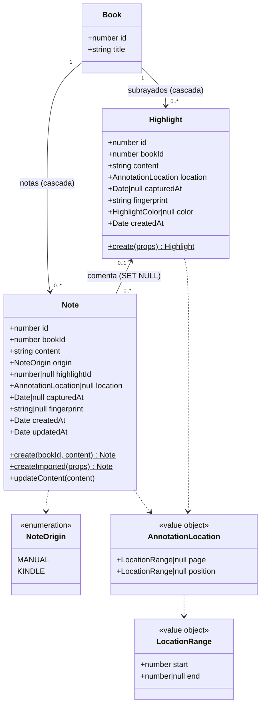
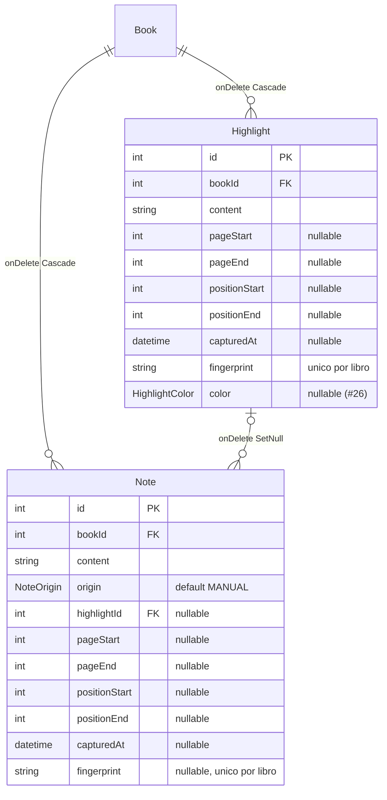
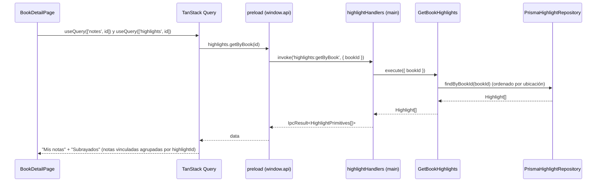

# Guía: modelo de anotaciones — notas del usuario y subrayados

> Feature #22 (`highlights_and_note_origin`). Prepara la importación del Kindle (#23) y
> la fecha de terminado sugerida (#24). Decisión de arquitectura: `docs/decisions/022-highlights-and-note-origin.md`.

## 1. La pregunta que responde el modelo

El usuario pidió: *"quiero diferenciar lo escrito por mí sobre el libro y lo resaltado"*.
Eso define dos cosas distintas:

| Concepto | Entidad | Quién lo escribió | De dónde viene |
|---|---|---|---|
| **Lo escrito por mí** | `Note` | El usuario | A mano en BookLog (`MANUAL`) o escrito en el Kindle (`KINDLE`) |
| **Lo resaltado** | `Highlight` | El autor del libro (el usuario solo lo marcó) | Hoy solo del Kindle |

Una nota del Kindle **sigue siendo una nota**: aparece en "Mis notas" con una etiqueta
"Kindle". Si en el Kindle se escribió sobre un subrayado, la nota queda **vinculada** a él
(`highlightId`) y también se muestra debajo del subrayado, como comentario.

## 2. Diagrama de clases (dominio)

## 3. Piezas del dominio

### `AnnotationLocation` (value object)

> **Actualizado en #23** (ADR 023): antes era `{ kind: PAGE | LOCATION, start, end }`, una
> sola referencia. El usuario pidió guardar **las dos** cuando el Kindle las da.

El Kindle referencia por **página** (`- Tu resaltado en la página 12`), por **posición**
(`- Your Highlight on Location 1200-1205`) o por ambas a la vez
(`en la página 12 | posición 180-183`), con un número suelto o un rango. El value object es
`{ page, position }`, cada uno un `LocationRange { start, end }` o `null`, inmutable
(`Object.freeze`), y lo construye `createAnnotationLocation`, que:

- exige **al menos una** de las dos (página o posición) y enteros positivos;
- rechaza un fin anterior al inicio;
- normaliza `12-12` a `12` (`end = null`), para que dos referencias equivalentes queden iguales.

La UI muestra la página si existe y, si no, la posición (`formatAnnotationLocation`). La
posición, más fina, es la que usa la importación para vincular notas y calcular la huella.
`locationLastPoint(range)` devuelve el fin del rango (o el inicio) y `rangeContains(range,
punto)` dice si un punto cae dentro de `[inicio, fin]`.

### `Highlight`

Texto resaltado, ubicación obligatoria, fecha del dispositivo (`capturedAt`, puede ser
`null` si no se pudo leer) y **huella obligatoria** (`fingerprint`). La huella la calcula
la importación (#23); el dominio solo exige que no esté vacía. Un subrayado no se edita:
solo se lista y se borra.

> **#26**: color opcional (`YELLOW | BLUE | PINK | ORANGE`) que trae la exportación del
> Cuaderno de la app de Kindle; los de My Clippings quedan sin color. La UI lo muestra con los
> tokens `highlight-*`. Ver `kindle-clippings-import.md` §9 y ADR 026.

### `Note` ampliada

- `origin` con default `MANUAL`: los datos anteriores a #22 (sin origen) se leen como manuales.
- Invariantes:
  - una nota `MANUAL` **no** puede tener ubicación, fecha del dispositivo ni huella
    (esos datos solo tienen sentido importados; las notas manuales siguen siendo
    reflexiones sobre el libro entero, ver ADR 006);
  - una nota `KINDLE` **necesita** huella, para no duplicarse al reimportar;
  - `highlightId` es opcional y positivo.
- `Note.create` sigue creando notas manuales (el flujo del modal no cambió).
  `Note.createImported` es la puerta de entrada que usará #23.

## 4. Persistencia

- El value object se guarda en **cuatro columnas planas** (`pageStart`, `pageEnd`,
  `positionStart`, `positionEnd`); `AnnotationLocationMapper` hace la conversión en ambos
  sentidos. Que al menos una exista lo garantiza el dominio, no la base.
- La migración `20261019150000_annotation_page_and_position` (#23) reemplazó las tres
  columnas originales (`locationKind`, `locationStart`, `locationEnd`) copiando cada
  ubicación a las columnas de página o de posición según su tipo. Los subrayados se
  ordenan por posición y luego por página.
- **Huella única por libro**: `@@unique([bookId, fingerprint])` en las dos tablas. En
  `Note` la columna es nullable; SQLite considera distintos todos los `NULL` de un índice
  único, así que las notas manuales (sin huella) no chocan entre sí.
- **Borrar un subrayado no borra notas**: la FK `Note.highlightId` es `ON DELETE SET NULL`.
  La nota del usuario sobrevive y queda suelta en "Mis notas".
- **Borrar un libro** borra en cascada sus notas y subrayados.
- La migración `20261019120000_add_highlights_and_note_origin` es no destructiva: Prisma
  recrea la tabla `Note` (SQLite no puede agregar una FK con `ALTER TABLE`) copiando todas
  las filas; `origin` toma el `DEFAULT 'MANUAL'`.

### Fechas: instante, no día calendario

`capturedAt` es la fecha **con hora** que escribe el Kindle (`Añadido el lunes, 14 de julio
de 2025 22:15:03`). A diferencia de `finishedAt` (ADR 020, día a mediodía local), es un
instante: se guarda tal cual. #24 la convertirá a día con `toCalendarNoon` cuando la
proponga como fecha de terminado.

## 5. Flujo de lectura en el detalle del libro

Al borrar un subrayado (`highlights:delete` → `DeleteHighlight`) se invalidan **las dos**
queries: los subrayados, porque falta uno, y las notas, porque las vinculadas ahora tienen
`highlightId = null`.

## 6. Qué deja listo para #23 y #24

- #23 (importación): crea `Highlight.create(...)` y `Note.createImported(...)` con la huella
  que calcule; el índice único por libro garantiza que reimportar no duplique (se detecta
  antes por huella o se atrapa el error de unicidad). El puerto `HighlightRepository` ya
  tiene `create`.
- #24 (fecha sugerida): tiene `capturedAt` tanto en subrayados como en notas del Kindle.
