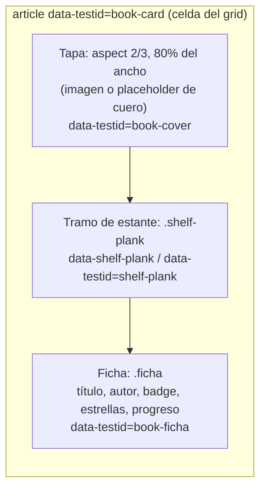
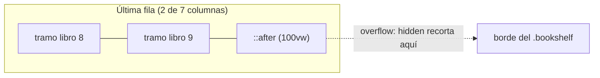

# Estantería responsive con CSS grid

> Feature #17 (`library_bookshelf_view`). Complementa `design-tokens-theming.md`.
> ADR: `docs/decisions/017-library-bookshelf-view.md`.

La Biblioteca muestra los libros **parados sobre estantes de madera**, con una ficha
de catálogo debajo de cada uno. La cantidad de libros por estante depende del ancho
de la ventana. Esta guía explica cómo se logra eso sólo con CSS, sin medir el DOM
desde JavaScript.

## 1. El problema: "un estante por fila" en un layout que fluye

Un estante es un elemento que recorre **toda una fila**. Pero en un layout
responsive no sabemos de antemano qué libros caen en cada fila: con 1200 px entran
7, con 640 px entran 3. Hay dos caminos:

| Enfoque | Cómo | Costo |
|---------|------|-------|
| **Agrupar en JS** | Medir el ancho con `ResizeObserver`, calcular columnas, partir el array en filas y renderizar `<Shelf>` por fila | Estado extra, re-render al redimensionar, jsdom no tiene `ResizeObserver` (más mocks en tests), riesgo de desfasaje con el CSS |
| **Cada celda dibuja su tramo** (elegido) | CSS grid `auto-fill`; cada libro trae su pedazo de estante debajo; sin separación horizontal los pedazos se tocan | Sólo CSS. Un detalle a resolver: la última fila incompleta |

## 2. El grid: `auto-fill` + `gap-x-0`

```tsx
<div className="bookshelf grid grid-cols-[repeat(auto-fill,minmax(9.5rem,1fr))] gap-x-0 gap-y-10">
```

- `repeat(auto-fill, minmax(9.5rem, 1fr))`: el navegador mete **tantas columnas de al
  menos 9.5rem como entren**, y reparte el sobrante (`1fr`) entre ellas. No hay
  breakpoints (`sm:`, `md:`...): el número de libros por estante sale solo del ancho.
- `gap-x-0`: las celdas de una fila quedan pegadas. La "separación" entre libros es
  padding **dentro** de cada celda (`px-3`), así el estante (que ocupa todo el ancho de
  la celda) no se corta.
- `gap-y-10`: aire entre un estante y los libros del estante de abajo.

## 3. Anatomía de una celda (`BookCard`)



¿Por qué los tramos de una misma fila quedan **a la misma altura**? Porque todas las
celdas de una fila tienen el mismo ancho (`1fr`) y la tapa tiene una proporción fija
(`aspect-[2/3]` sobre el 80% del ancho). Misma altura de tapa ⇒ el estante empieza a
la misma `y` en todas las celdas ⇒ se lee como una sola tabla de madera.

Las fichas pueden tener alturas distintas (el progreso sólo aparece en
Leyendo/Pausado/Abandonado), pero eso ocurre **debajo** del estante, así que no lo
desalinea. Además el grid estira las celdas de una fila a la misma altura y la ficha
usa `flex-1`, así que todas las fichas de una fila miden lo mismo.

## 4. La última fila incompleta

Con 9 libros y 7 columnas, la segunda fila tiene 2 libros: los tramos sólo cubrirían
2/7 del ancho y el estante quedaría "cortado". Se resuelve con un pseudo-elemento:

```css
@utility bookshelf {
  overflow: hidden;

  & > :last-child [data-shelf-plank]::after {
    content: "";
    position: absolute;
    left: 100%;          /* empieza donde termina el último tramo */
    width: 100vw;        /* "infinito" hacia la derecha */
    top: 0;
    bottom: 0;
    background: inherit; /* misma madera */
    box-shadow: inherit; /* misma sombra */
  }
}
```

- Sólo el **último libro** lo tiene, y el último libro siempre está en la última fila.
- El contenedor tiene `overflow: hidden` y **no tiene padding lateral**, así que el
  pseudo-elemento se recorta exactamente en el borde derecho del estante.
- En filas completas el último libro está en la última columna: la prolongación cae
  fuera del contenedor y se recorta entera (no se ve).



## 5. La madera, sin colores nuevos

`shelf-plank` no introduce tokens: deriva la madera de tokens existentes con
`color-mix`, así cambia sola con el tema.

```css
--plank-top:   color-mix(in oklab, var(--color-brass) 42%, var(--color-chrome));
--plank-front: color-mix(in oklab, var(--color-brass) 22%, var(--color-chrome));
```

Un `linear-gradient` pinta la cara superior (4 px más clara), un filo de luz de 1 px y
una línea de sombra abajo; encima va `var(--texture-wood)` (la veta de #16). Dos
sombras (`--relief-deep`) dan profundidad: una suave hacia arriba (los libros
"apoyan") y otra hacia abajo (el estante proyecta sombra sobre la pared).

## 6. Placeholder de cuero

Cuando no hay tapa (o la imagen falla), el libro es un tomo encuadernado:

- Fondo `bg-leather` o `bg-spine` (cuero rojo o verde), **alternado por `id`** para que
  un estante sin tapas no sea monótono. Es determinista: el mismo libro siempre tiene
  el mismo color (`data-cover-tone`).
- Grano `texture-paper` encima, marco `border-double border-brass/60` y un icono en
  `text-brass` (detalles en latón).
- `book-hinge`: degradado sobre el borde izquierdo que simula el pliegue del lomo. Se
  aplica también a las portadas reales para que parezcan libros y no imágenes planas.

## 7. Cómo se testea

jsdom no calcula layout, así que los tests verifican **la estructura que produce el
layout**:

- El grid usa `auto-fill`/`minmax` y `gap-x-0`, sin breakpoints fijos.
- Cada `book-card` es hijo directo del grid y tiene exactamente un `shelf-plank`, en
  orden tapa → estante → ficha.
- Toda la información (título, autor, badge, progreso, estrellas) está dentro de la
  ficha.
- `main.css` define `shelf-plank` con `texture-wood` y tokens, y `bookshelf` con la
  prolongación `:last-child ... ::after` + `overflow: hidden`, sin colores fijos.

El aspecto real se verificó con capturas en ambos temas y dos anchos.
