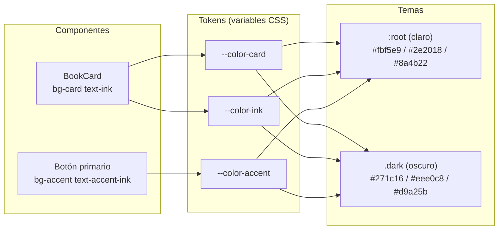
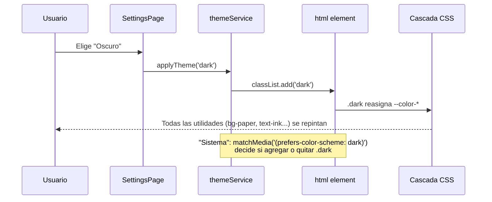
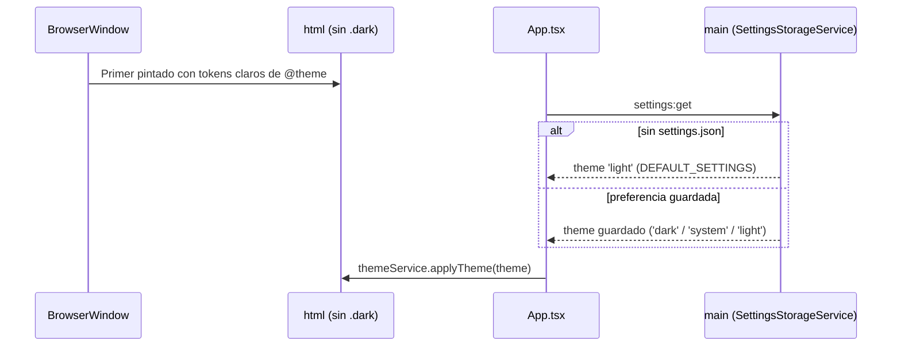
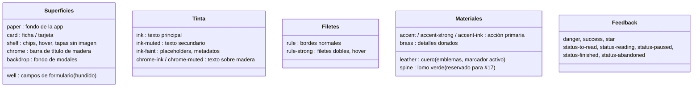
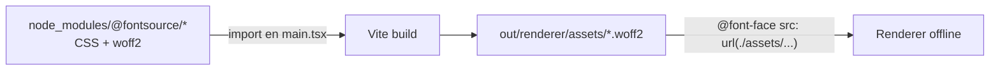

# Tokens de diseño y temas con Tailwind CSS v4

> Guía conceptual de la feature #16 (`retro_library_theme`). Explica cómo BookLog
> pasa de "clases de color sueltas" (`bg-slate-800`, `text-indigo-400`) a un
> **sistema de tokens semánticos** que permite tener dos temas completos
> (claro = pergamino, oscuro = biblioteca de noche) sin duplicar una sola clase.

---

## 1. El problema: colores crudos

Antes de esta feature, un botón primario se veía así:

```tsx
<button className="bg-indigo-600 hover:bg-indigo-500 text-white">Guardar</button>
```

y una tarjeta así:

```tsx
<div className="bg-white dark:bg-slate-800/40 border-slate-200 dark:border-slate-800 text-slate-900 dark:text-slate-100">
```

Problemas:

1. **El componente decide el color exacto**, no el *papel* que cumple ese color. Si
   mañana el acento deja de ser índigo hay que tocar ~100 archivos.
2. **Cada tema duplica clases** (`X dark:Y`). Con ~600 clases de color, el modo claro
   prácticamente no existía porque casi nadie escribía la variante `dark:`.
3. **No hay consistencia**: `slate-300`, `slate-200` y `slate-100` se usaban
   indistintamente para "texto principal".

## 2. La idea: tokens semánticos

Un **token** es un nombre que describe *para qué* sirve un color, no *qué* color es:

| Token | Rol | Claro (pergamino) | Oscuro (biblioteca de noche) |
|-------|-----|-------------------|------------------------------|
| `paper` | Fondo de la app | crema `#f2e8d5` | nogal `#1c1410` |
| `card` | Ficha/tarjeta | papel claro `#fbf5e9` | madera `#271c16` |
| `ink` | Texto principal | tinta marrón `#2e2018` | hueso cálido `#eee0c8` |
| `accent` | Acción primaria | siena `#8a4b22` | latón/lámpara `#d9a25b` |
| `rule` | Bordes/filetes | `#d3bf9c` | `#45352a` |

El componente ahora dice **qué es**, y el tema decide **cómo se ve**:

```tsx
<button className="bg-accent hover:bg-accent-strong text-accent-ink">Guardar</button>
<div className="ficha text-ink">
```



## 3. Cómo lo implementa Tailwind v4: `@theme`

En Tailwind v4 ya no hay `tailwind.config.ts`: la configuración vive en el CSS.
El bloque `@theme` hace **dos cosas a la vez**:

1. Declara variables CSS en `:root` (capa `theme`).
2. Registra utilidades a partir del *namespace* de cada variable.

```css
@theme {
  --color-paper: #f2e8d5;   /* genera bg-paper, text-paper, border-paper, ... */
  --color-ink: #2e2018;     /* genera text-ink, bg-ink, ... */
  --font-display: "Libre Baskerville", Georgia, serif; /* genera font-display */
  --shadow-md: ...;          /* redefine la utilidad shadow-md */
}
```

Lo clave es que la utilidad generada **no copia el valor**, sino que referencia la
variable:

```css
.bg-paper { background-color: var(--color-paper); }
```

Por eso, si reasignamos `--color-paper` en otro selector, **todas** las utilidades
que la usan cambian solas.

### Modificadores de opacidad

`bg-accent/10` también funciona con variables: Tailwind genera
`color-mix(in oklab, var(--color-accent) 10%, transparent)` (y un hex estático de
respaldo para navegadores sin `color-mix`; Chromium 120 de Electron 28 sí lo soporta,
así que siempre gana la versión con variable).

## 4. Cambiar de tema = reasignar variables bajo `.dark`

La feature #15 ya aplicaba la clase `dark` en `<html>` desde `themeService`
(`dark`, `light` o `system` vía `matchMedia`). Ahora esa clase sólo **reasigna los
mismos tokens**:

```css
@layer base {
  .dark {
    color-scheme: dark;
    --color-paper: #1c1410;
    --color-ink: #eee0c8;
    --color-accent: #d9a25b;
    /* ... todos los demás tokens ... */
  }
}
```

¿Por qué en `@layer base`? Tailwind ordena las capas `theme → base → components →
utilities`. Los valores por defecto de `@theme` están en la capa `theme`; al poner
el override en `base` (una capa posterior) gana siempre, sin pelear especificidad.



Consecuencia: **ningún componente necesita `dark:`**. Un test
(`tests/renderer/test_retro_library_theme.test.ts`) lo verifica, junto con que no
queden colores crudos de la paleta de Tailwind en `src/renderer`.

`@custom-variant dark` sigue declarado por si algún caso puntual necesitara una
variante (p. ej. invertir una imagen), pero la regla es preferir un token.

### Tema por defecto: claro (feature #18)

Sin preferencia guardada, BookLog arranca en el tema **claro** (pergamino). Eso
depende de tres lugares que tienen que coincidir:

1. `DEFAULT_SETTINGS.theme = 'light'` en `SettingsStorageService` (main): es lo que
   devuelve `settings:get` cuando no hay `settings.json` o el tema guardado es inválido.
2. Los *fallbacks* del renderer: `App.tsx` aplica `'light'` si `settings:get` falla, y
   `SettingsPage` arranca su estado en `'light'`.
3. El **primer pintado**: `index.html` no trae la clase `dark` y los valores de
   `@theme` (`:root`) ya son los claros, así que antes de que llegue la respuesta IPC
   la página ya es papel claro. La ventana además se muestra recién en
   `ready-to-show`. Resultado: no hay "flash" oscuro.



Una preferencia ya guardada se respeta. Contracara conocida: quien eligió "Oscuro"
ve el papel claro durante el instante que tarda la respuesta IPC (se aceptó a favor
de que el caso por defecto no parpadee).

## 5. Mapa de tokens



## 6. Utilidades propias con `@utility`

Además de colores, la estética "biblioteca retro" usa algunas piezas reutilizables
definidas con `@utility` (se comportan como cualquier utilidad de Tailwind: aceptan
variantes y se purgan si no se usan):

| Utilidad | Qué hace |
|----------|----------|
| `texture-paper` | Grano de papel: SVG inline con `feTurbulence` (ruido fractal) tintado de sepia. |
| `texture-wood` | Veta de madera: el mismo ruido pero estirado en horizontal (`baseFrequency="0.006 0.32"`). |
| `ficha` | Ficha de catálogo: fondo `card` + grano + borde + **segundo filete interior** (dos `box-shadow inset`) + sombra con relieve. |
| `ficha-float` | Igual que `ficha` pero con sombra más profunda (modales). Funciona cambiando la variable `--ficha-elevation`, no `box-shadow`, para no pisarse con `ficha`. |
| `rule-double` | Filete doble horizontal (`border-bottom: 3px double`). |
| `shelf-plank` | Tramo de estante de madera (feature #17): mezcla `chrome` + `brass` con `color-mix`, veta `texture-wood` y sombra de relieve. Ver `css-grid-bookshelf-layout.md`. |
| `bookshelf` | Contenedor de la estantería: recorta (`overflow: hidden`) la prolongación del último tramo de estante. |
| `book-hinge` | Sombra del pliegue del lomo sobre una tapa (portada o placeholder de cuero). |

Las texturas son `data:` URIs, así que **no hay imágenes externas** y la CSP
(`img-src 'self' data:`) ya las permite. Su opacidad es distinta por tema
(`--texture-paper` también se reasigna bajo `.dark`).

Las sombras (`shadow-sm`, `shadow-md`, ...) se redefinieron en `@theme` usando
variables `--relief-light/--relief-shade/--relief-deep`: en claro son marrones
suaves con un brillo interior arriba (relieve); en oscuro, negras más densas.

## 7. Tipografía empaquetada (offline)

Las fuentes se instalan como paquetes npm de **@fontsource** y se importan en
`src/renderer/src/main.tsx`:

```ts
import '@fontsource-variable/lora/wght.css'          // texto (variable 400–700)
import '@fontsource/libre-baskerville/latin-400.css' // títulos
```

Vite copia los `.woff2` a `out/renderer/assets/` y reescribe las URLs, así que la app
funciona sin red. Se agregó `font-src 'self' data:` a la CSP de `index.html`.



En `main.css`, `html { font-family: var(--font-serif) }` aplica Lora a todo el texto y
`h1–h4 { font-family: var(--font-display) }` aplica Libre Baskerville a los títulos
sin tocar cada componente.

## 8. Contraste (WCAG AA)

Cada par texto/fondo principal se verifica en el test con la fórmula de luminancia
relativa de WCAG (umbral 4.5:1): `ink`, `ink-muted`, `ink-faint`, `accent`, `danger`
y los cinco `status-*` sobre `paper`/`card`, en ambos temas. Las estrellas (no-texto)
sólo necesitan 3:1.

## 9. Cómo agregar o cambiar un color

1. ¿Ya existe un token con ese **rol**? Usalo.
2. Si es un rol nuevo: agregá `--color-<rol>` en `@theme` (valor claro) **y** en
   `.dark` (valor oscuro). El test falla si falta en alguno.
3. Usalo como `bg-<rol>`, `text-<rol>`, `border-<rol>/40`, etc.
4. Nunca uses `slate-*`, `indigo-*`, `white`, `black`... en `src/renderer`.
