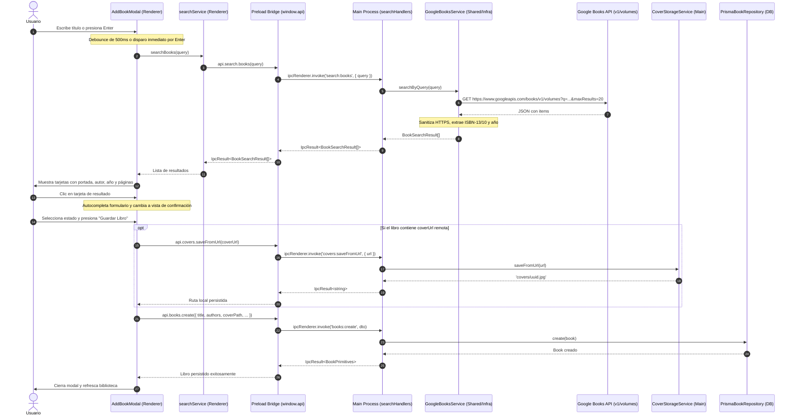
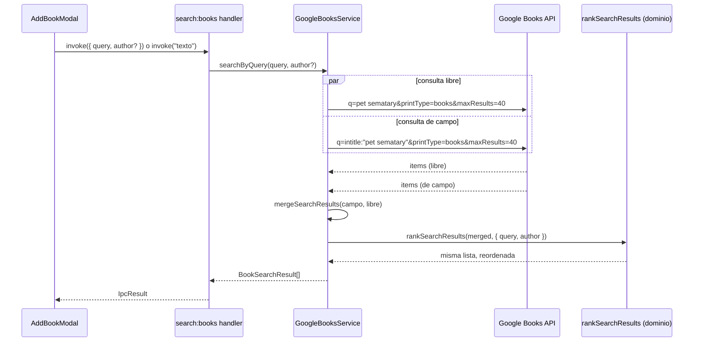
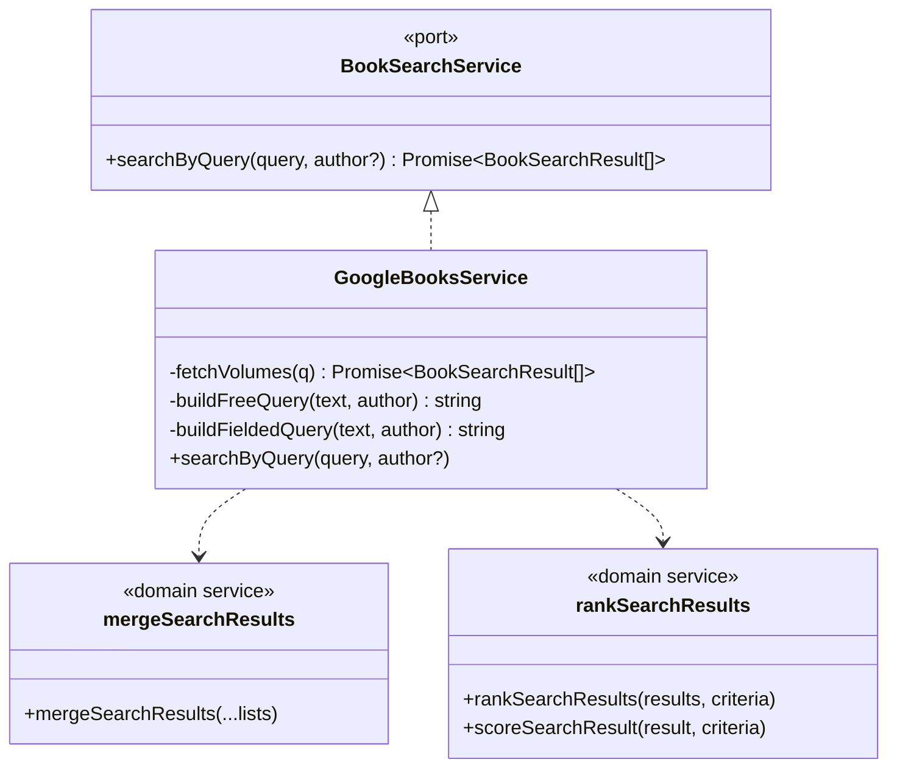

# Integración con APIs Externas: Google Books en BookLog

Esta guía técnica explica la arquitectura, el diseño y las decisiones implementadas para consumir APIs externas (Google Books API) en una aplicación de escritorio con Electron, Clean Architecture y React.

---

## 1. Arquitectura Hexagonal y Puertos

En Clean Architecture, el núcleo de la aplicación (dominio y casos de uso) nunca debe depender de implementaciones tecnológicas concretas ni de servicios web de terceros.

### Puerto de Búsqueda (`src/shared/domain/ports/BookSearchService.ts`)
El dominio define únicamente la interfaz abstracta que necesita:

```typescript
export interface BookSearchResult {
  googleBooksId?: string | null
  title: string
  authors: string[]
  description?: string | null
  publisher?: string | null
  publishedDate?: string | null
  pageCount?: number | null
  coverUrl?: string | null
  isbn?: string | null
}

export interface BookSearchService {
  // `author` es opcional desde la feature #21 (ver sección 5)
  searchByQuery(query: string, author?: string | null): Promise<BookSearchResult[]>
}
```

### Adaptador de Infraestructura (`src/shared/infrastructure/api/GoogleBooksService.ts`)
La infraestructura provee la implementación concreta que interactúa con la API REST de Google Books:

```
[ Domain: BookSearchService ] <--- implements --- [ Infrastructure: GoogleBooksService ]
                                                           |
                                                        (HTTP)
                                                           v
                                                [ Google Books REST API ]
```

---

## 2. Flujo Completo de Búsqueda y Persistencia Offline

El siguiente diagrama de secuencia ilustra la interacción entre el usuario, el modal de React, la capa IPC, el servicio de Google Books y el almacenamiento local:



---

## 3. Sanitización y Transformación de Datos

Las respuestas de la API pública de Google Books pueden contener valores nulos, esquemas `http://` inseguros o formatos de fecha variables. `GoogleBooksService` aplica reglas estrictas:

1. **Forzado de HTTPS en Portadas:**
   Google Books habitualmente retorna URLs con protocolo `http://books.google.com/...`. Todas las URLs se sanitizan reemplazando `http://` por `https://` para evitar advertencias de contenido mixto y asegurar conexiones cifradas.
2. **Preferencia de Resolución de Portadas:**
   Se utiliza prioritariamente `imageLinks.thumbnail`; si no está presente, se recurre a `imageLinks.smallThumbnail`.
3. **Extracción Prioritaria de ISBN:**
   Se examina `industryIdentifiers` buscando primero el estándar moderno `ISBN_13`. Si no existe, se utiliza `ISBN_10` como alternativa de respaldo.
4. **Normalización de Fechas a Años de 4 Dígitos:**
   Google Books puede devolver fechas en formato `YYYY-MM-DD`, `YYYY-MM` o `YYYY`. Se extrae mediante expresión regular el año de 4 dígitos para visualización consistente en las tarjetas.
5. **Manejo Defensivo de Autores:**
   Si el campo `authors` viene indefinido o no es un arreglo, se devuelve una lista vacía `[]`, previniendo errores de tiempo de ejecución.

---

## 4. Patrones de Experiencia de Usuario (UX)

### Debounce y Disparo Inmediato
- Al tipear en el buscador, un temporizador de 500ms retrasa la petición de red para no saturar la API ni emitir peticiones por cada tecla pulsada.
- Si el usuario presiona la tecla `Enter` o hace clic en el botón "Buscar", se cancela cualquier temporizador pendiente y se dispara la búsqueda de forma inmediata.
- Las consultas con menos de 3 caracteres no ejecutan peticiones de red y muestran una guía amigable.

### Prevención de Condiciones de Carrera (*Race Conditions*)
En aplicaciones interactivas, una petición anterior más lenta podría resolver después de una petición posterior más rápida. Para evitar que resultados obsoletos sobreescriban la pantalla, se mantiene una referencia mutable `searchRequestIdRef`:

```typescript
const requestId = ++searchRequestIdRef.current
const res = await searchService.searchBooks(trimmed)
if (requestId !== searchRequestIdRef.current) {
  return // Se descarta el resultado porque hay una búsqueda más nueva en curso
}
```

### Transición hacia Confirmación y Persistencia Offline-First
Cuando el usuario selecciona un libro:
1. El modal autocompleta todos los campos disponibles (`title`, `authors`, `pageCount`, `isbn`, `coverUrl`, `googleBooksId`).
2. Se activa automáticamente la pestaña de formulario manual, permitiendo al usuario revisar y editar cualquier dato antes de guardar.
3. Se muestra un banner informativo que confirma que los datos fueron precargados desde Google Books.
4. Al confirmar el guardado, la portada se descarga físicamente a la carpeta local de BookLog (`userData/covers/`), garantizando que la portada seguirá disponible aun cuando la aplicación no tenga conexión a internet.

---

## 5. Consultas Combinadas y Ranking Local (feature #21)

### El problema
Con una sola consulta `q=<texto>&maxResults=20`, el orden de Google Books no siempre
coincide con lo que busca una persona: para "pet sematary" aparecían primero guías de
estudio, revistas y traducciones, y la novela de Stephen King quedaba abajo o fuera de los
20 resultados. Google ofrece operadores de campo (`intitle:`, `inauthor:`) y el filtro
`printType=books`, pero un único criterio nunca es perfecto: `intitle:` es preciso pero
pierde coincidencias aproximadas; la consulta libre encuentra más pero ordena peor.

### La solución: dos consultas en paralelo + ranking propio
`GoogleBooksService.searchByQuery(query, author?)` hace tres cosas, y sólo tres:

1. **Arma dos consultas** (ambas con `printType=books&maxResults=40`):
   - libre: `<texto> <autor>`;
   - de campo: `intitle:"<texto>" inauthor:"<autor>"` (cada parte sólo si tiene valor).
2. **Las lanza en paralelo** con `Promise.allSettled` y combina lo que llegue con
   `mergeSearchResults` (sin duplicados por `googleBooksId`). Si una falla, se usa la otra;
   si fallan las dos, se propaga el mismo error de siempre.
3. **Delega el orden** en `rankSearchResults`, una función pura de dominio.



### ¿Por qué el ranking vive en el dominio?
Decidir "qué resultado es más relevante para el usuario" es una regla de negocio de
BookLog, no un detalle de Google. Por eso `rankSearchResults` y `mergeSearchResults` están
en `src/shared/domain/services/`: no conocen HTTP ni Electron y se testean con datos en
memoria. Si mañana se agregara Open Library como segunda fuente, reutilizaría el mismo
ranking.



### Cómo se calcula el puntaje
Título y autores se normalizan (minúsculas, sin tildes, sin puntuación). Pesos en
`RELEVANCE_WEIGHTS`:

| Señal | Puntos |
|---|---|
| Título idéntico al texto | 100 |
| Título que empieza con el texto | 60 |
| Título que contiene la frase | 45 |
| Si no, proporción de palabras del texto presentes en el título | hasta 30 |
| Campo autor: proporción de sus palabras presentes en algún autor | hasta 50 |
| Sin campo autor: palabras del texto que coinciden con un autor | hasta 40 |
| Tiene portada / ISBN / páginas | +10 / +5 / +5 |

Si el texto libre trae el autor ("it stephen king"), esas palabras cuentan como autor y se
quitan antes de comparar el título, así "It" sigue siendo coincidencia exacta. **Ningún
resultado se descarta** (se muestran todas las ediciones, en cualquier idioma) y ante empate
se conserva el orden original (orden estable).

### Campo "Autor" en el modal
La pestaña de búsqueda tiene un segundo input opcional (`data-testid="search-author-input"`).
Se busca si **cualquiera** de los dos campos tiene 3 caracteres o más. El debounce y el
`searchRequestIdRef` contra condiciones de carrera se comparten entre ambos inputs: cambiar el
autor cancela el temporizador pendiente y una respuesta vieja nunca pisa a la nueva.

### Cómo se testea sin red
`tests/fixtures/googleBooksPetSematary.ts` contiene respuestas grabadas (recortadas) de la API.
El `fetchFn` inyectado en `GoogleBooksService` responde una u otra según si la URL usa
`intitle:`/`inauthor:`. Así se verifican la combinación, los fallos parciales y que la
edición de Stephen King quede primera, sin API key ni cuota.
