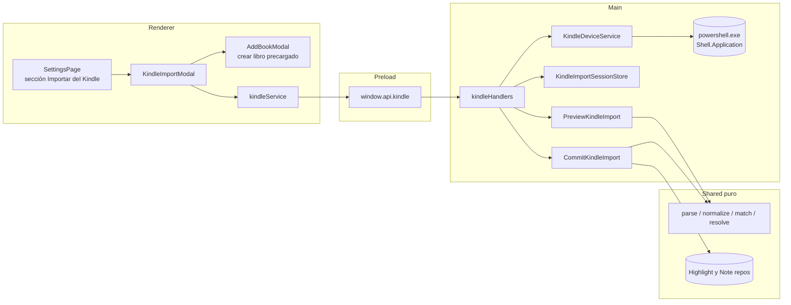
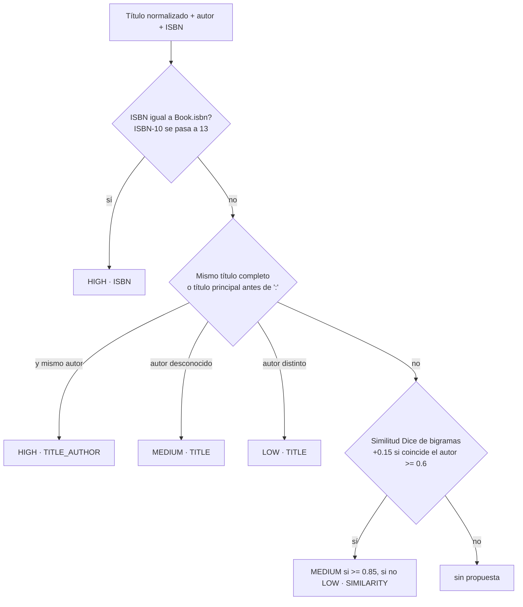
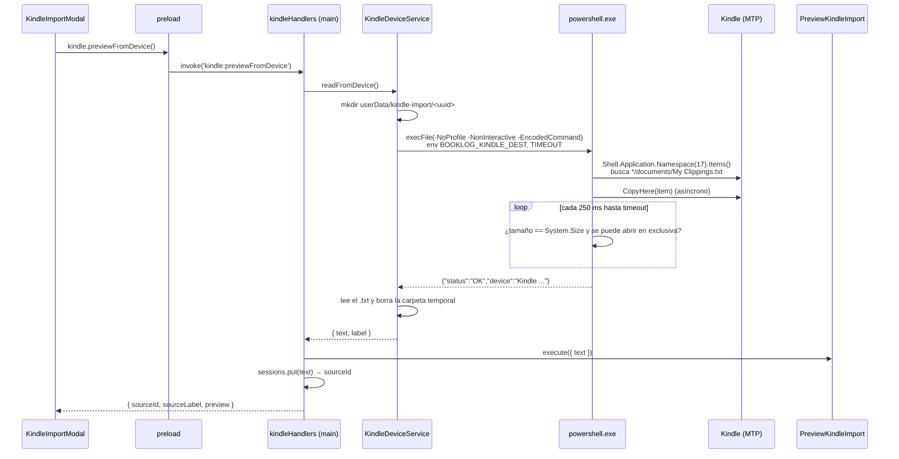

# Guía: importar subrayados y notas desde `My Clippings.txt`

> Feature #23 (`kindle_clippings_import`). Usa el modelo de anotaciones de la #22
> (`docs/guides/annotations-model.md`). Decisión de arquitectura:
> `docs/decisions/023-kindle-clippings-import.md`.

## 1. Qué es `My Clippings.txt`

El Kindle guarda todo lo que subrayás, anotás o marcás en **un solo archivo de texto**,
`documents/My Clippings.txt`, al que solo **agrega** entradas: nunca borra ni modifica.

```text
AI Engineering_ Building ... -- Chip Huyen -- 2024 -- ... -- Anna’s Archive (Chip Huyen)
- Tu resaltado en la página 12 | posición 180-183 | Añadido el lunes, 14 de julio de 2025 22:15:03

Texto subrayado...
==========
AI Engineering_ Building ... (Chip Huyen)
- La nota en la página 12 | posición 183 | Añadido el lunes, 14 de julio de 2025 22:16:00

Lo que escribí sobre ese subrayado.
==========
```

- UTF-8 **con BOM** (U+FEFF al principio) y fin de línea **CRLF** (Windows).
- Cada entrada: línea 1 = título (el Kindle agrega el autor entre paréntesis), línea 2 =
  metadatos, línea en blanco, cuerpo; separador `==========`.
- Tipos: resaltado, nota, marcador. Ubicación: página, posición (unidad propia del Kindle)
  o **ambas**, con número suelto o rango.
- El idioma del encabezado y el de la fecha son **independientes**: en la muestra real hay
  `- Your Highlight on Location 512-515 | Added on martes, 8 de julio de 2025 21:40:12`.

Consecuencia de "solo agrega": si editás un subrayado o una nota, el archivo tiene **las
dos versiones**. La importación tiene que decidir cuál conservar.

## 2. Arquitectura: dónde vive cada pieza



- **Dominio puro** (`src/shared/domain/services/kindle/`): parser, fechas, limpieza de
  títulos, matching, huella, dedupe y vínculo. Sin I/O: se testea con strings.
- **Aplicación**: `PreviewKindleImport` (no escribe nada) y `CommitKindleImport`
  (crea con las asignaciones finales).
- **Main**: `KindleDeviceService` (PowerShell + lectura de archivo) y los handlers IPC.
- **Renderer**: el modal de vista previa. Nunca ve rutas ni el contenido completo del
  archivo: solo un `sourceId`.

## 3. Parsing (`parseKindleClippings`)

1. Quita los BOM y normaliza `\r\n` → `\n`.
2. Separa bloques por líneas `==========` (tolera que falte el último separador).
3. Para cada bloque: título = primera línea con texto; metadatos = la siguiente; cuerpo =
   el resto.
4. Los metadatos se parten por `|` y cada dato se busca **por separado**:
   - tipo en el primer segmento (`resaltado|subrayado|highlight`, `nota|note`,
     `marcador|bookmark`);
   - `página|page N[-M]` y `posición|location|loc. N[-M]` en cualquier segmento (completa
     rangos abreviados `1200-05` → `1200-1205`);
   - fecha en el segmento `Añadido el …` / `Added on …`, con `parseKindleDate`, que prueba
     castellano (`14 de julio de 2025 22:15:03`), inglés US (`July 14, 2025 10:15:03 PM`) e
     inglés UK, en **hora local**.
5. Descarta marcadores y entradas sin texto; lo que no entiende lo **cuenta** como no
   reconocido en vez de abortar.

## 4. Títulos sucios y matching

`normalizeKindleTitle` limpia los títulos que dejan las descargas:

| Patrón | Ejemplo | Resultado |
|---|---|---|
| Segmentos `--` + hash + Anna’s Archive | `AI Engineering_ Building … -- Chip Huyen -- … -- d3b6… -- Anna’s Archive (Chip Huyen)` | `AI Engineering: Building …` / Chip Huyen / ISBN 9781098166304 |
| `(Z-Library)` y autor repetido | `This Is How … (Nicole Perlroth) (Z-Library) (Nicole Perlroth)` | `This Is How …` |
| Prefijo de sitio y `_` | `_OceanofPDF.com_Eisenhorn_The_Omnibus_-_Dan_Abnett` | `Eisenhorn The Omnibus` |
| ePubLibre `[NNNN] (rX.Y)`, `Autor - Título` | `Borges, Jorge Luis - Ficciones [19293] (r1.2)` | `Ficciones` |
| Guiones como espacios | `De-animales-a-dioses-…` | `De animales a dioses …` |
| `_` como `:` | `Legado de cenizas _ La historia de la CIA` | `Legado de cenizas: La historia de la CIA` |
| `Apellido, Nombre` | `(King, Stephen)` | Stephen King |

`- ` separa autor y título: se elige el lado que se parece al autor conocido (el de los
paréntesis finales).

`matchKindleBook` propone un libro de la biblioteca en orden de fiabilidad:



Los títulos se agrupan por el **encabezado exacto** del Kindle: dos encabezados del mismo
libro son grupos distintos (sus posiciones no son comparables), pero el usuario puede
asignarlos al mismo libro.

## 5. Resolver un grupo (`resolveKindleAnnotations`)

- **Subrayados editados**: dos subrayados se consideran versiones del mismo si sus rangos
  se tocan **y** comparten texto (uno contiene al otro, o 25+ caracteres en común). Se
  conserva el **más reciente**. Dos subrayados contiguos que comparten solo la posición
  del borde no comparten texto y quedan los dos.
- **Notas editadas**: una nota es un borrador si una nota **más nueva en la misma
  ubicación** empieza con su texto (incluye duplicados exactos). Notas distintas en el
  mismo lugar se importan todas.
- **Vínculo nota → subrayado**: la nota comenta al subrayado cuyo rango `[inicio, fin]`
  (inclusive) contiene la ubicación de la nota. Se compara por **posición**; si a alguna de
  las dos le falta, por página. Con varios candidatos gana el de **fin más cercano** a la
  nota; si empatan, el **más reciente anterior** a la fecha de la nota. Sin candidato, la
  nota queda suelta.
- **Huella**: `kindle-v1:` + hash (cyrb53, puro) de tipo + posición (o página si no hay)
  + texto con espacios colapsados. Sin título ni fecha: la misma entrada da la misma huella
  aunque cambie cómo se interpreta el encabezado.

## 6. Leer el Kindle desde Electron: MTP vía PowerShell

Los Kindle actuales se conectan por **MTP** (aparecen en "Este equipo" sin letra de
unidad). Node (`fs`) no puede abrir rutas MTP y el diálogo de Electron tampoco permite
elegir archivos dentro de un dispositivo MTP. Lo que sí puede es el **Shell de Windows**:



Detalles que importan:

- **Script constante + datos por variables de entorno**: el script nunca interpola rutas
  ni nada que venga del usuario; `execFile` no usa shell. `-EncodedCommand` (UTF-16LE en
  Base64) evita problemas de comillas y la política de ejecución de `.ps1`.
- **No se hardcodea el nombre del dispositivo**: se recorren todos los ítems de "Este
  equipo" y todos sus almacenamientos buscando `documents\My Clippings.txt`. Si un Kindle
  viejo aparece como unidad con letra, se copia con `Copy-Item`.
- **`CopyHere` es asíncrono**: devuelve antes de copiar. El script espera a que el archivo
  tenga el tamaño esperado (o un tamaño estable si el dispositivo no lo informa) y se pueda
  abrir en exclusiva. Con timeout (60 s) y un margen extra en Node para matar el proceso.
- **Errores tipados**: `KindleDeviceError` con `NOT_FOUND | TIMEOUT | UNSUPPORTED | FAILED`
  y `KindleFileError`; el handler los traduce a códigos IPC (`KINDLE_NOT_FOUND`, ...).
- **Fallback**: si no se encuentra el Kindle, el modal ofrece "Elegir archivo .txt"
  (`dialog.showOpenDialog` con filtro `.txt`); cancelar no es un error (`data: null`).
- **Testeable sin dispositivo**: el `PowerShellRunner` se inyecta; los tests simulan cada
  respuesta del script.

## 7. Vista previa, asignación y commit

```mermaid
sequenceDiagram
    participant U as Usuario
    participant M as KindleImportModal
    participant A as AddBookModal
    participant H as kindleHandlers
    participant C as CommitKindleImport

    M-->>U: grupos con cantidades, badge de confianza y selector
    U->>M: corrige un libro / "No importar"
    U->>M: "+ Crear libro…"
    M->>A: abre con título, autor e ISBN normalizados
    A-->>M: onCreated(book) → selección del grupo = book.id
    U->>M: Importar
    M->>H: kindle:commit { sourceId, assignments }
    H->>C: execute({ text de la sesión, assignments })
    C->>C: valida todos los libros antes de escribir
    loop por libro y grupo
        C->>C: resolveKindleAnnotations(grupo)
        C->>C: salta huellas existentes; crea Highlight y Note KINDLE<br/>con highlightId del subrayado nuevo o previo
    end
    C-->>M: informe (importados / omitidos por duplicado)
    M->>M: invalida queries highlights, notes, books, book
```

Reimportar el mismo archivo no duplica: el commit lee las huellas que el libro ya tiene y
la base además tiene `@@unique([bookId, fingerprint])`. Una nota nueva puede vincularse a
un subrayado importado en una corrida anterior.

## 8. Números de la muestra real del usuario

2652 entradas → 1775 resaltados y 852 notas útiles (18 marcadores y 7 vacíos ignorados,
0 sin reconocer), 38 títulos. Tras resolver: 1446 subrayados (329 versiones viejas
descartadas) y 302 notas (550 borradores o duplicados descartados), 301 de ellas
vinculadas a un subrayado.
