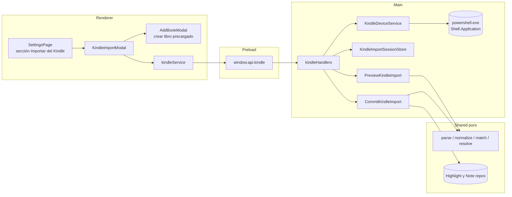
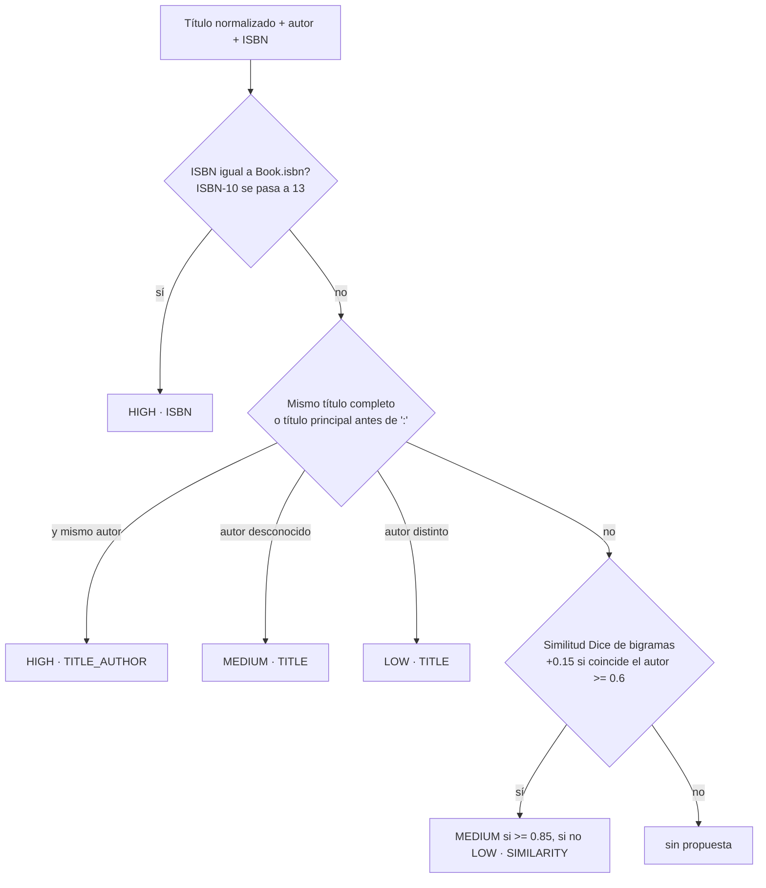
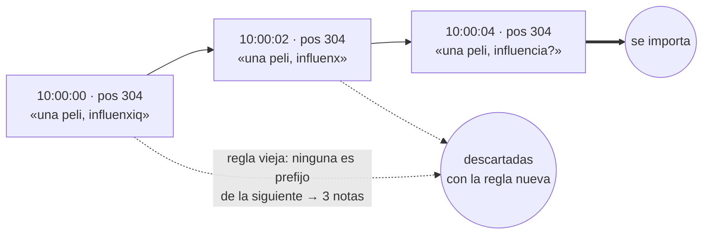
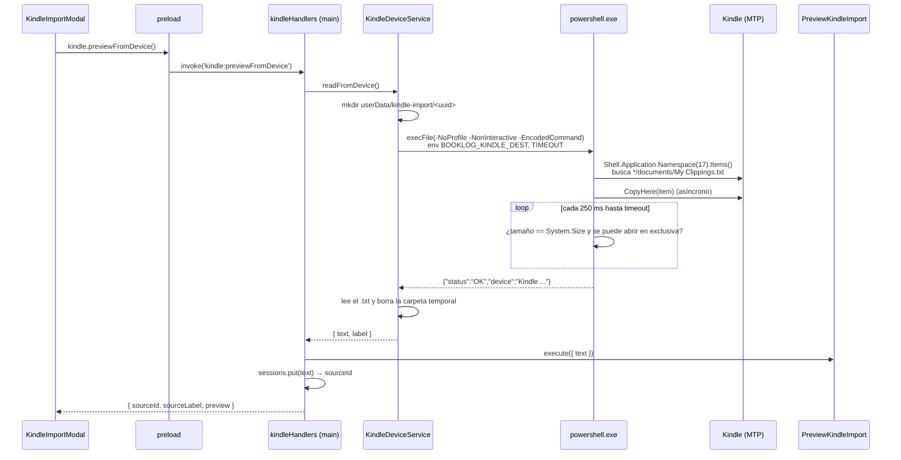
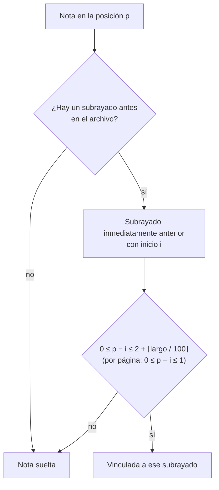
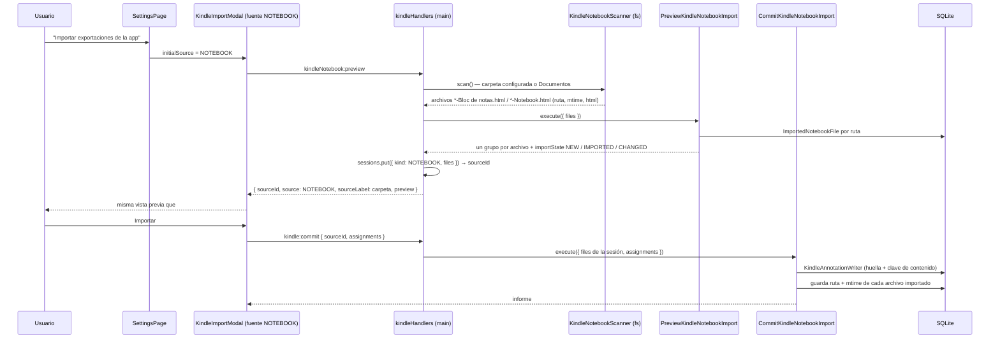
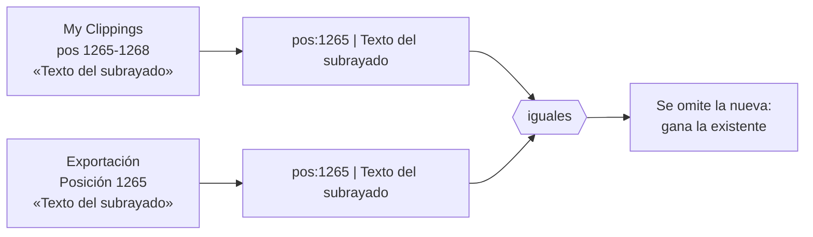

# Guía: importar subrayados y notas desde `My Clippings.txt`

> Feature #23 (`kindle_clippings_import`). Usa el modelo de anotaciones de la #22
> (`docs/guides/annotations-model.md`). Decisión de arquitectura:
> `docs/decisions/023-kindle-clippings-import.md`. Ajustes de la #25
> (`kindle_import_refinements`): una nota por ubicación, orden de la vista previa y búsqueda
> automática al crear un libro — `docs/decisions/025-kindle-import-refinements.md`.
> Exportaciones del Cuaderno de la app de Kindle (#26, `kindle_app_notebook_import`): §9 y
> `docs/decisions/026-kindle-app-notebook-import.md`.

## 1. Qué es `My Clippings.txt`

El Kindle guarda todo lo que subrayás, anotás o marcás en **un solo archivo de texto**,
`documents/My Clippings.txt`, al que solo **agrega** entradas: nunca borra ni modifica.

```text
AI Engineering_ Building ... -- Chip Huyen -- 2024 -- ... -- Anna’s Archive (Chip Huyen)
- Tu resaltado en la página 12 | posición 180-183 | Añadido el lunes, 14 de julio de 2025 22:15:03

Texto subrayado...
==========
AI Engineering_ Building ... (Chip Huyen)
- La nota en la página 12 | posición 183 | Añadido el lunes, 14 de julio de 2025 22:16:00

Lo que escribí sobre ese subrayado.
==========
```

- UTF-8 **con BOM** (U+FEFF al principio) y fin de línea **CRLF** (Windows).
- Cada entrada: línea 1 = título (el Kindle agrega el autor entre paréntesis), línea 2 =
  metadatos, línea en blanco, cuerpo; separador `==========`.
- Tipos: resaltado, nota, marcador. Ubicación: página, posición (unidad propia del Kindle)
  o **ambas**, con número suelto o rango.
- El idioma del encabezado y el de la fecha son **independientes**: en la muestra real hay
  `- Your Highlight on Location 512-515 | Added on martes, 8 de julio de 2025 21:40:12`.

Consecuencia de "solo agrega": si editás un subrayado o una nota, el archivo tiene **las
dos versiones**. La importación tiene que decidir cuál conservar.

## 2. Arquitectura: dónde vive cada pieza



- **Dominio puro** (`src/shared/domain/services/kindle/`): parser, fechas, limpieza de
  títulos, matching, huella, dedupe y vínculo. Sin I/O: se testea con strings.
- **Aplicación**: `PreviewKindleImport` (no escribe nada) y `CommitKindleImport`
  (crea con las asignaciones finales).
- **Main**: `KindleDeviceService` (PowerShell + lectura de archivo) y los handlers IPC.
- **Renderer**: el modal de vista previa. Nunca ve rutas ni el contenido completo del
  archivo: solo un `sourceId`.

## 3. Parsing (`parseKindleClippings`)

1. Quita los BOM y normaliza `\r\n` → `\n`.
2. Separa bloques por líneas `==========` (tolera que falte el último separador).
3. Para cada bloque: título = primera línea con texto; metadatos = la siguiente; cuerpo =
   el resto.
4. Los metadatos se parten por `|` y cada dato se busca **por separado**:
   - tipo en el primer segmento (`resaltado|subrayado|highlight`, `nota|note`,
     `marcador|bookmark`);
   - `página|page N[-M]` y `posición|location|loc. N[-M]` en cualquier segmento (completa
     rangos abreviados `1200-05` → `1200-1205`);
   - fecha en el segmento `Añadido el …` / `Added on …`, con `parseKindleDate`, que prueba
     castellano (`14 de julio de 2025 22:15:03`), inglés US (`July 14, 2025 10:15:03 PM`) e
     inglés UK, en **hora local**.
5. Descarta marcadores y entradas sin texto; lo que no entiende lo **cuenta** como no
   reconocido en vez de abortar.

## 4. Títulos sucios y matching

`normalizeKindleTitle` limpia los títulos que dejan las descargas:

| Patrón | Ejemplo | Resultado |
|---|---|---|
| Segmentos `--` + hash + Anna’s Archive | `AI Engineering_ Building … -- Chip Huyen -- … -- d3b6… -- Anna’s Archive (Chip Huyen)` | `AI Engineering: Building …` / Chip Huyen / ISBN 9781098166304 |
| `(Z-Library)` y autor repetido | `This Is How … (Nicole Perlroth) (Z-Library) (Nicole Perlroth)` | `This Is How …` |
| Prefijo de sitio y `_` | `_OceanofPDF.com_Eisenhorn_The_Omnibus_-_Dan_Abnett` | `Eisenhorn The Omnibus` |
| ePubLibre `[NNNN] (rX.Y)`, `Autor - Título` | `Borges, Jorge Luis - Ficciones [19293] (r1.2)` | `Ficciones` |
| Guiones como espacios | `De-animales-a-dioses-…` | `De animales a dioses …` |
| `_` como `:` | `Legado de cenizas _ La historia de la CIA` | `Legado de cenizas: La historia de la CIA` |
| `Apellido, Nombre` | `(King, Stephen)` | Stephen King |

`- ` separa autor y título: se elige el lado que se parece al autor conocido (el de los
paréntesis finales).

`matchKindleBook` propone un libro de la biblioteca en orden de fiabilidad:



Los títulos se agrupan por el **encabezado exacto** del Kindle: dos encabezados del mismo
libro son grupos distintos (sus posiciones no son comparables), pero el usuario puede
asignarlos al mismo libro.

## 5. Resolver un grupo (`resolveKindleAnnotations`)

- **Subrayados editados**: dos subrayados se consideran versiones del mismo si sus rangos
  se tocan **y** comparten texto (uno contiene al otro, o 25+ caracteres en común). Se
  conserva el **más reciente**. Dos subrayados contiguos que comparten solo la posición
  del borde no comparten texto y quedan los dos.
- **Notas editadas (#25)**: **una sola nota por ubicación, la más reciente** (fecha y, a
  igual fecha, orden en el archivo). La ubicación es la posición si la nota la tiene y si no
  la página (`noteLocationKey`, el mismo criterio que la huella). La regla de la #23 (borrador
  = prefijo de una nota más nueva) no alcanzaba: el autoguardado también registra
  correcciones **en el medio** del texto, que no son prefijos.



  El vínculo con el subrayado y la huella se calculan sobre la nota que queda. Las notas
  KINDLE guardadas con la regla vieja no se tocan: si el archivo sigue teniendo la versión
  final, reimportar la agrega (si no estaba) y deja las otras; borrarlas es decisión del
  usuario.
- **Vínculo nota → subrayado**: la nota comenta al subrayado cuyo rango `[inicio, fin]`
  (inclusive) contiene la ubicación de la nota. Se compara por **posición**; si a alguna de
  las dos le falta, por página. Con varios candidatos gana el de **fin más cercano** a la
  nota; si empatan, el **más reciente anterior** a la fecha de la nota. Sin candidato, la
  nota queda suelta.
- **Huella**: `kindle-v1:` + hash (cyrb53, puro) de tipo + posición (o página si no hay)
  + texto con espacios colapsados. Sin título ni fecha: la misma entrada da la misma huella
  aunque cambie cómo se interpreta el encabezado.

## 6. Leer el Kindle desde Electron: MTP vía PowerShell

Los Kindle actuales se conectan por **MTP** (aparecen en "Este equipo" sin letra de
unidad). Node (`fs`) no puede abrir rutas MTP y el diálogo de Electron tampoco permite
elegir archivos dentro de un dispositivo MTP. Lo que sí puede es el **Shell de Windows**:



Detalles que importan:

- **Script constante + datos por variables de entorno**: el script nunca interpola rutas
  ni nada que venga del usuario; `execFile` no usa shell. `-EncodedCommand` (UTF-16LE en
  Base64) evita problemas de comillas y la política de ejecución de `.ps1`.
- **No se hardcodea el nombre del dispositivo**: se recorren todos los ítems de "Este
  equipo" y todos sus almacenamientos buscando `documents\My Clippings.txt`. Si un Kindle
  viejo aparece como unidad con letra, se copia con `Copy-Item`.
- **`CopyHere` es asíncrono**: devuelve antes de copiar. El script espera a que el archivo
  tenga el tamaño esperado (o un tamaño estable si el dispositivo no lo informa) y se pueda
  abrir en exclusiva. Con timeout (60 s) y un margen extra en Node para matar el proceso.
- **Errores tipados**: `KindleDeviceError` con `NOT_FOUND | TIMEOUT | UNSUPPORTED | FAILED`
  y `KindleFileError`; el handler los traduce a códigos IPC (`KINDLE_NOT_FOUND`, ...).
- **Fallback**: si no se encuentra el Kindle, el modal ofrece "Elegir archivo .txt"
  (`dialog.showOpenDialog` con filtro `.txt`); cancelar no es un error (`data: null`).
- **Testeable sin dispositivo**: el `PowerShellRunner` se inyecta; los tests simulan cada
  respuesta del script.

## 7. Vista previa, asignación y commit

```mermaid
sequenceDiagram
    participant U as Usuario
    participant M as KindleImportModal
    participant A as AddBookModal
    participant H as kindleHandlers
    participant C as CommitKindleImport

    M-->>U: grupos con cantidades, badge de confianza y selector
    U->>M: ordena (subrayados, notas, fecha, título)
    U->>M: corrige un libro / "No importar"
    U->>M: "+ Crear libro…"
    M->>A: initialSearch {título, autor} + initialValues {título, autor, ISBN}
    A->>A: pestaña de búsqueda, busca sin debounce (requestId)
    U->>A: elige un resultado (o pasa a la pestaña manual precargada)
    A-->>M: onCreated(book) → selección del grupo = book.id
    U->>M: Importar
    M->>H: kindle:commit { sourceId, assignments }
    H->>C: execute({ text de la sesión, assignments })
    C->>C: valida todos los libros antes de escribir
    loop por libro y grupo
        C->>C: resolveKindleAnnotations(grupo)
        C->>C: salta huellas existentes; crea Highlight y Note KINDLE<br/>con highlightId del subrayado nuevo o previo
    end
    C-->>M: informe (importados / omitidos por duplicado)
    M->>M: invalida queries highlights, notes, books, book
```

**Orden de la vista previa (#25).** Selector "Ordenar por": más subrayados (por defecto),
más notas, más recientes (última fecha del grupo; los grupos sin fecha al final) y título
A-Z; los empates se resuelven por título. `sortKindleGroups` devuelve una copia ordenada y
la selección sigue indexada por `group.key`, así que reordenar nunca cambia qué libro está
asignado a cada grupo.

**Crear libro con búsqueda automática (#25).** `AddBookModal` acepta `initialSearch`
(`{ query, author? }`): abre en la pestaña de búsqueda con el título y el autor normalizados
en los campos de la #21 y ejecuta la búsqueda de inmediato, sin esperar el debounce. Usa el
mismo `executeSearch`, así que el `requestId` descarta la respuesta si el usuario busca otra
cosa antes. `initialValues` sigue precargando la pestaña manual por si ningún resultado
sirve. Sin `initialSearch`, el modal se comporta como antes.

Reimportar el mismo archivo no duplica: el commit lee las huellas que el libro ya tiene y
la base además tiene `@@unique([bookId, fingerprint])`. Una nota nueva puede vincularse a
un subrayado importado en una corrida anterior.

## 8. Números de la muestra real del usuario

2652 entradas → 1775 resaltados y 852 notas útiles (18 marcadores y 7 vacíos ignorados,
0 sin reconocer), 38 títulos. Tras resolver: 1446 subrayados (329 versiones viejas
descartadas) y 302 notas (550 borradores o duplicados descartados), 301 de ellas
vinculadas a un subrayado.

Con la regla de la #25 (una nota por ubicación): **46 notas** (806 descartadas), 45
vinculadas a un subrayado. Las 256 que sobraban eran correcciones del autoguardado en el
medio del texto que la regla del prefijo no detectaba.

## 9. Exportaciones del Cuaderno de la app de Kindle (#26)

### Por qué `My Clippings.txt` dejó de alcanzar

Desde fines de julio de 2026 (firmware 5.20.1) el Kindle del usuario **no escribe los
subrayados nuevos** en `My Clippings.txt` ni en el `.sdr` del libro: el archivo quedó con
fecha 30/7/2026 y los `.yjr` de los libros leídos después no tienen anotaciones. Los
subrayados viven en una base interna que no se ve por USB/MTP y se sincronizan con la nube de
Amazon (diagnóstico en `progress/explore_kindle_clippings.md`). La vía que sí funciona es la
**app de Kindle para PC**: abre el libro, muestra el Cuaderno con todo lo sincronizado (incluso
las notas escritas en el celular) y tiene **Exportar cuaderno**, que guarda un HTML por libro
en Documentos.

### El formato

- Nombre: `<título crudo>-Bloc de notas.html` (app en castellano) o `<título>-Notebook.html`
  (en inglés), en la carpeta Documentos (`app.getPath('documents')`).
- XHTML UTF-8 **mal formado**: las etiquetas se cruzan.

```html
<div class='bookTitle'>El crepúsculo de los ídolos -- Friedrich Nietzsche -- 1889 -- <hash> -- Anna’s Archive
</div>, de <div class='authors'>
Friedrich Nietzsche
</div>
<h2 class='sectionHeading'>8</h2>
<h3 class='noteHeading'>Subrayado (<span class='highlight_yellow'>amarillo</span>) - Posición 872</div><div class='noteText'>Texto subrayado…</h3>
<h3 class='noteHeading'>Nota - Posición 873</div><div class='noteText'>primera línea
segunda línea</h3>
<h3 class='noteHeading'>Subrayado (<span class='highlight_yellow'>amarillo</span>) - Carta II &gt; Posición 1069</div><div class='noteText'>…</h3>
```

- `div.bookTitle` es el mismo título sucio de My Clippings (se limpia con
  `normalizeKindleTitle`); `div.authors` trae el autor **limpio** y tiene prioridad.
- Encabezado: tipo (`Subrayado`/`Nota`, `Highlight`/`Note`), color
  (`highlight_yellow|blue|pink|orange`), capítulo opcional antes de `>` y `Posición N` /
  `Página N` (`Location`/`Page`).
- **Sin fechas y sin posición final**: solo la de inicio.
- Un subrayado partido entre páginas llega como **dos entradas con la misma posición** y
  textos distintos: son dos subrayados.
- La nota aparece justo después del subrayado que comenta, con posición = inicio del
  subrayado + 0..2.

### Parser tolerante (`parseKindleNotebook`)

No se usa un parser XML estricto (fallaría con este HTML). Se buscan las etiquetas de apertura
con las clases conocidas (`bookTitle`, `authors`, `sectionHeading`, `noteHeading`, `noteText`)
y el contenido de cada una llega hasta el **primer cierre de bloque** (`</div>`, `</h3>`…) o la
próxima etiqueta conocida. Después: `<br>` → salto de línea, se quitan las etiquetas, se
decodifican las entidades (`&gt;`, `&amp;`, `&#233;`…) y se recortan espacios por línea (las
notas multilínea conservan sus saltos). Marcadores y entradas vacías se ignoran; los
encabezados sin tipo o sin página/posición numérica (p. ej. `Page xii`) se cuentan como no
reconocidos.

### Vínculo nota → subrayado y huella (`resolveKindleNotebook`)

La exportación refleja el estado actual (no hay versiones viejas que descartar), así que se
conservan todos los subrayados y todas las notas. Como no hay posición final, el vínculo de la
#23 (la nota dentro del rango `[inicio, fin]`) no sirve. Regla nueva:



El margen crece con el largo del subrayado porque la nota queda al **final** del subrayado
(una posición del Kindle son unos 128 bytes). La huella es `kindle-nb-v1:` + hash de tipo +
ubicación de inicio + texto normalizado: estable al reexportar.

### Flujo completo



- **Sin PowerShell**: Documentos es un directorio normal; alcanza con `fs.readdir` + `stat`.
  No se recorren subcarpetas.
- **La carpeta es configurable** en Configuración: "Cambiar carpeta…" abre el diálogo nativo
  en el main y la guarda en `settings.json`; "Usar Documentos" la reinicia. El renderer nunca
  manda la ruta (igual que en #23 nunca manda la del `.txt`).
- **Archivos ya importados**: tabla `ImportedNotebookFile` (ruta única + fecha de
  modificación). Misma ruta y misma fecha = "Ya importado" (arranca en "No importar"); otra
  fecha = "Cambió desde la última importación" (reexportado). Reimportarlo igual es seguro.
- **Vista previa compartida**: `KindleImportModal` recibe la fuente `NOTEBOOK` y muestra el
  nombre del archivo y el estado; el matching, el orden, "+ Crear libro…" con búsqueda
  precargada y "No importar" son los mismos de #23/#25.

### Dedupe entre fuentes

Un libro puede tener subrayados importados de My Clippings (con fecha y rango de posición) y
después llegar los mismos en la exportación (sin fecha y solo con el inicio). Las huellas son
distintas (cada fuente usa campos distintos), así que el escritor común
(`KindleAnnotationWriter`) compara también una **clave de contenido**:



- Clave = inicio de la ubicación (posición, o página si no hay posición) + texto normalizado
  (NFC, espacios colapsados, sin bordes). Solo el **inicio**, porque la exportación no tiene fin.
- Vale para subrayados y para notas, en los dos sentidos (exportación después de My Clippings y
  al revés). Gana lo existente: el subrayado de My Clippings conserva su fecha (útil para la
  fecha de terminado, #24) y queda sin color.
- Si el subrayado de la exportación se omitió por existir, sus notas se vinculan al existente.
- Mismo inicio con otro texto (subrayado editado o partido) = anotaciones distintas.

### Color y fecha

`Highlight.color` (`YELLOW | BLUE | PINK | ORANGE`, opcional) se agregó con una migración no
destructiva (`ALTER TABLE ... ADD COLUMN`). La sección Subrayados muestra una marca chica con
los tokens `highlight-*` de `main.css` (valores para claro y oscuro). Los subrayados de la
exportación quedan con `capturedAt = null`; `suggestFinishedDate` (#24) ya ignoraba las
anotaciones sin fecha, así que la sugerencia de fecha de terminado no cambia.

### Números de las muestras reales

| Exportación | Entradas | Subrayados | Notas | Vinculadas | Otros |
|---|---|---|---|---|---|
| El crepúsculo de los ídolos | 60 | 53 | 7 (1 multilínea) | 7 | 8 secciones, todo amarillo, varios subrayados partidos con la misma posición (58, 893, 1065, 1067, 1244 ×3, 1327) |
| Frankenstein | 8 | 8 | 0 | — | 6 encabezados con capítulo (`Carta II > …`), 2 secciones |
| Tercera exportación de la misma carpeta | 49 | 48 | 1 | 1 | 4 secciones |

0 entradas no reconocidas, 0 vacías y 0 huellas repetidas en las tres.
